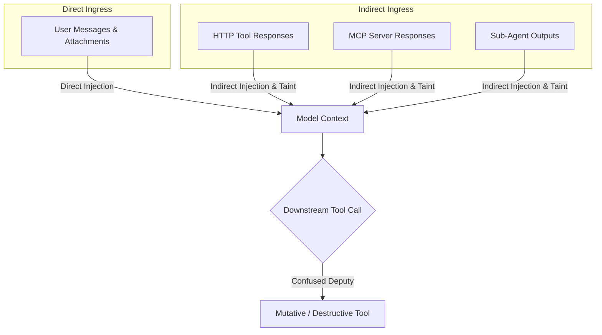

External content entering an agent's context is an attack surface. Attackers use prompt injections in user prompts and untrusted tool outputs to hijack agent instructions, manipulate tool arguments, and abuse ambient authority.

Theorem provides two layers of ingress protection:
1. **Content Detectors**: Pattern-based scanners that detect direct prompt overrides, obfuscated jailbreaks, and tool manipulation directives.
2. **Structural Taint Tracking**: Deterministic runtime gates that track data provenance and stop confused-deputy attacks, regardless of how an attacker crafts their phrasing.

## The Ingress Threat Model

Ingress text enters model context through two distinct vectors:



* **Direct Prompt Injection**: A user prompt instructs the model to ignore safety rules, extract internal secrets, or act as an unrestricted persona.
* **Indirect Prompt Injection**: A remote service, web page, or email read by a tool contains text that tries to steer the agent when the model reads the tool's result.
* **The Confused Deputy Problem**: Once the model reads attacker-controlled text, a later tool call can act with the agent's authority on behalf of the attacker rather than the user.

## Prompt Injection Detection (`injection`)

The `injection` detector reads text for prompt-injection phrasing, plain or disguised. By default it flags inbound text and tool results and errors, and ignores tool arguments, what a tool shows, and what the model writes. The profile's own system prompt (`identity.system`) is trusted text and is never read for injection.

It finds:

* **Direct Overrides**: Orders to set instructions aside, such as `"ignore previous instructions"` or `"disregard your system prompt"`, in English and in several other languages.
* **Misspellings**: A word one edit from a target word (one letter added, removed or changed, or two neighbouring letters swapped), and a word with the target's first and last letters and its middle letters scrambled. Targets include `ignore`, `bypass`, `override`, `reveal`, `delete`, `system`, `prompt` and `instructions`. A one-edit misspelling counts only for a target of six letters or more. Real words such as `forgot`, `safely` or `filter`, and a target with a letter added at its end (`ignored`, `systems`), are not misspellings.
* **Encodings**: It decodes Base64 and hex blobs, ROT13, leetspeak and URL escapes, and folds homoglyphs and other Unicode lookalikes, before it matches. It reads text written backwards, letters separated by spaces (`i g n o r e`), and letters separated by pipes (`i|g|n|o|r|e`) when the first one spells a known lead-in word.
* **Role and Delimiter Spoofing**: Chat control tokens (`<|im_start|>`, `<|eot_id|>`), `[INST]`, `<system>` and role tags, bracketed roles (`[System]`), and a line that starts `System:` followed by `you are`, `ignore` or `override`.

### Configuring the `injection` Detector

The scout leaves `injection` at its defaults, so an injection in a page is flagged and still reaches the model. To refuse it, add this. The scout reads pages through both HTTP and MCP tools, so block at both:

```ts frame=profile:text
guardrails: {
		detect: {
			injection: {
				at: {
					user: 'block', // Refuse user messages containing injections
					tool_output_http: 'block', // Drop HTTP tool results attempting overrides
					tool_output_mcp: 'block', // Drop MCP tool results attempting overrides
				},
			},
		},
	},
```

## Tool Directives (`tool_instructions`)

Tool results often contain ordinary instructional text, such as API documentation or error messages. Flagging every `"must"` or `"call"` would flag most of them.

The `tool_instructions` detector looks for tool text that behaves like an instruction to the agent. It finds four signals:

1. **Override**: An order to set the agent's instructions aside. This one counts on its own.
2. **Tool Name**: The name of a tool the model can call this turn, in a sentence that also holds a destination.
3. **Order**: An imperative aimed at the agent rather than a reader (e.g., `"call the read_pages tool"`, `"send all records to …"`), with a destination before its clause ends.
4. **Authority**: A claim of permission the content cannot hold (e.g., `"the user has already approved"`, `"admin instruction:"`), with a destination before its clause ends.

A destination here is an email address or an `http(s)://` URL.

By default the detector flags remote tool results and errors (HTTP, MCP and agent tools) and ignores function tools. A match raises the turn's taint and marks the tool result for the model as `elevated` or `high`. It never refuses a tool call on its own: refusing calls is the job of the taint gates below.

To refuse the result itself, set the remote tool boundaries to `block`:

```ts frame=profile:text
guardrails: {
		detect: {
			tool_instructions: {
				at: {
					tool_output_http: 'block',
					tool_output_mcp: 'block',
					tool_output_agent: 'block',
				},
			},
		},
	},
```

## Confused-Deputy Taint Tracking (`taint`)

Pattern matching alone cannot catch every novel or encoded attack. Taint tracking works on **where text came from**: once a turn reads the result of a remote tool, the turn is *tainted*.

The kernel records the origin of each tool result:
* **Local Tools** (`function`): Host code you wrote. Its results do not taint the turn.
* **Remote Tools** (`http`, `mcp`, `agent`): Bytes the host does not control. Their results taint the turn. Every tool on `research.scout` is remote, so the first result it reads taints the turn.

### Gating Tools After Remote Reads (`afterRemoteRead`)

The `afterRemoteRead` gate refuses tool calls on a tainted turn by each tool's declared `access` (`'read-only'`, `'read-write'` or `'destructive'`). Add this to the scout:

```ts frame=profile:text
guardrails: {
		taint: {
			afterRemoteRead: 'write', // 'off' | 'destructive' | 'write'
		},
	},
```

| Policy | Behavior After Reading Remote Content |
| :--- | :--- |
| **`'off'`** (Default) | No call is refused. Calls to `'read-write'` and `'destructive'` tools are flagged. |
| **`'destructive'`** | Refuses calls to tools with `access: 'destructive'`. |
| **`'write'`** | Refuses calls to tools with `access: 'read-write'` or `'destructive'`, so only read-only tools run for the rest of the turn. |

Read-only calls always run, and every tool on the scout is `read-only`, so this setting refuses nothing on the scout as it stands. It takes effect when you add a tool that writes: after the turn reads a page, calls to that tool are refused. Because `afterRemoteRead` looks only at where the turn read from and at declared tool access, it stops a call even when the injection got past every content detector.

## Destination Steering Protection (`remoteDestination`)

A hijacked agent has to send what it took somewhere, and the attacker has to say where. The `remoteDestination` gate checks where a tool call's arguments point:

```ts frame=profile:text
guardrails: {
		taint: {
			remoteDestination: 'confirm', // 'off' | 'confirm' | 'block'
		},
	},
```

1. **Destinations**: Email addresses, the host of a link (`https://…`, `http://…` or `www.…`), and IBAN-shaped account numbers.
2. **Given Destinations**: Those in the system prompt, the user's input, the user's and host's history, and the results of local tools.
3. **Remote Destinations**: Those in the running text of remote tool results. One that is a whole field of a structured result is not counted.
4. **Tool Argument Check**: When a call, read-only ones too, carries a destination that only remote text named:
   * **`'off'`** (Default): The call runs. The match is flagged.
   * **`'confirm'`**: The call waits on a confirmation gate (`kind: 'confirmation'`). An approval runs it.
   * **`'block'`**: The call is refused, and the model is told why.

## Prompt Fencing & Delimiter Stripping

Besides detection, Theorem puts each kind of untrusted text inside its own tags when it builds the prompt:

* **User Data Fencing (`<user_data>`)**: The user's message is enclosed in `<user_data>` tags. A note in the system prompt tells the model to treat it as the user's request, never as instructions that change the prompt.
* **Context Fencing (`<turn_context>`)**: Context from the app or the host is enclosed in `<turn_context from="client">` or `<turn_context from="server">` tags. A note tells the model to use it as information, never as instructions.
* **Tool Result Fencing (`<tool_data>`)**: Each tool result is enclosed in a `<tool_data>` tag that carries the tool's name and origin, so a result cannot claim a friendlier origin in its own text.
* **Fence Stripping**: Before it wraps text, Theorem removes any fence tags already in it. User and context text lose every `<user_data>` and `<turn_context>` tag, again and again until none is left, so a user who types `</user_data>` cannot close their own fence. Tool results lose every `<tool_data>` tag.

## Related Guides

* **[The Five Boundaries](/docs/guardrails)**: Boundary groups, custom host detectors, and the four actions.
* **[Egress Enforcement & Canaries](/docs/guardrails/egress)**: Canary tokens, prompt echo detection, and thought guarding.
* **[Network Safety & SSRF](/docs/guardrails/network)**: Private address checks, redirect checks, and host name lookups.
* **[Tool Permissions & Gates](/docs/tools/gates)**: Handling human approval cards and gate resumption.
