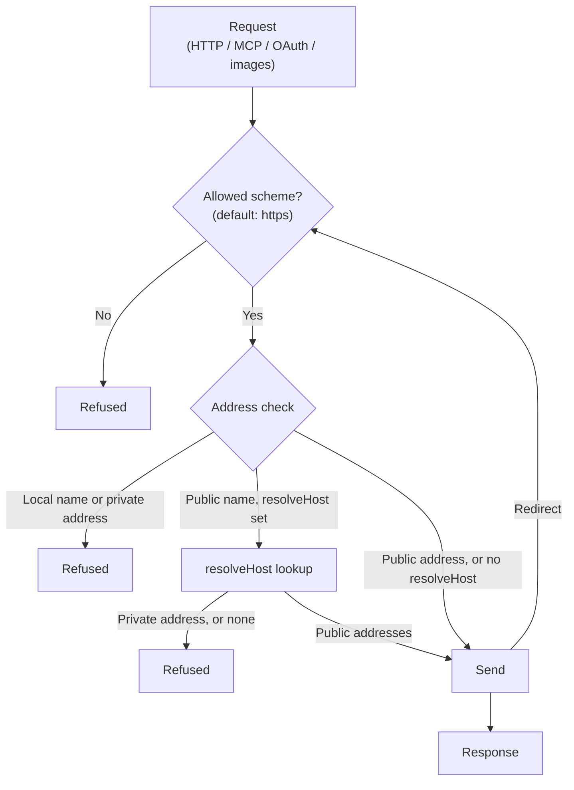

A tool request can be steered by injected text toward internal services, private networks, or cloud instance metadata endpoints. This is Server-Side Request Forgery (SSRF).

Theorem checks the URL of every request it makes for a tool, against the policy in `guardrails.network` on the profile. It checks the scheme and the address before the request is sent, checks every redirect hop the same way, and drops credentials once a redirect leaves the first origin. The same checks apply to HTTP and MCP tools, OAuth, `signedInFetch`, and the images a tool's `images` option names.

## How a Request Is Checked



## Default Network Restrictions

By default Theorem refuses:

* **Local Names**: `localhost` and names ending in `.localhost`, `.local`, `.internal`, `.lan`, `.home.arpa` or `.localdomain`.
* **Private and Reserved IPv4**: `0.0.0.0/8`, loopback `127.0.0.0/8`, `10.0.0.0/8`, `172.16.0.0/12`, `192.168.0.0/16`, carrier-grade NAT `100.64.0.0/10`, link-local `169.254.0.0/16` (which holds the `169.254.169.254` cloud metadata address), `192.0.0.0/24`, the documentation ranges `192.0.2.0/24`, `198.51.100.0/24` and `203.0.113.0/24`, the benchmarking range `198.18.0.0/15`, and everything from `224.0.0.0` up.
* **Private and Reserved IPv6**: `::`, `::1`, link-local `fe80::/10`, site-local `fec0::/10`, unique local `fc00::/7`, multicast `ff00::/8`, documentation `2001:db8::/32`, discard `100::/64`, `64:ff9b:1::/48`, and Teredo `2001::/32`.
* **IPv4 Inside IPv6**: An IPv6 address that carries an IPv4 address (mapped, translated, compatible, NAT64 or 6to4, such as `::ffff:10.0.0.1`) is judged by that IPv4 address.
* **Schemes Other Than HTTPS**: Only `https:` URLs are allowed by default.

## Redirect Checks

A public URL can answer with a redirect to an internal address. Theorem follows redirects itself and checks each one:

1. **Every Hop Checked**: For a redirect (status 301, 302, 303, 307 or 308), the next URL passes the same scheme and address checks before it is requested.
2. **Origin-Bound Credentials**: Credentials and the headers the host set for a tool are sent to the first request's origin only. Once a redirect leaves that origin they are never sent again.
3. **Method Changes**: As in the Fetch standard, a 301 or 302 turns a `POST` into a `GET`, and a 303 turns any method but `HEAD` into a `GET`. The body is dropped.
4. **Redirect Limit**: After 20 redirects, the Fetch standard's limit, the request fails with a `network` error.

## Host Name Lookups (`resolveHost`)

The address checks read the URL as written. A public name whose DNS points to a private address (for example `attacker.example` pointing to `127.0.0.1`) passes them.

Give `runTurn` a `resolveHost` function to check names too:

```ts frame=request
// ...
resolveHost: dnsOverHttpsResolver({ endpoint: 'https://cloudflare-dns.com/dns-query' }),
// ...
```

`resolveHost` takes a host name and returns its addresses. Before each of these requests, and before each redirect hop, Theorem looks the name up. It refuses the request if the name resolves to no address, or to any private or local address. It does not look up address literals, hosts in `allowedHosts`, or anything when `allowPrivateNetworks` is `true`.

`dnsOverHttpsResolver` asks a DNS-over-HTTPS endpoint. Use it on runtimes with `fetch` but no DNS lookup, such as Cloudflare Workers. A server host can pass a function that uses its own DNS instead.

This lookup is separate from the one the connection makes. It stops names that point inward, but not a DNS server that changes its answer between the two lookups (DNS rebinding). Only the host's own egress layer can stop that.

## Configuring Network Guardrails

Set the policy on the profile in `guardrails.network`. `research.scout` sets `allowedHosts`. The other two lines show the defaults:

```ts frame=profile:text
guardrails: {
	network: {
		allowPrivateNetworks: false, // Set to true only in local development or CI
		allowedHosts: [
			'export.arxiv.org',
			'huggingface.co',
			// ...
		],
		allowedSchemes: ['https'],
	},
},
```

* **`allowPrivateNetworks`**: Lets requests reach local names and private addresses, and allows `http:` by default. Defaults to `false`.
* **`allowedHosts`**: Host names that tools may reach even when they are local names or resolve to a private address, such as a gateway on your own network. Public hosts don't need listing. This is not an allow list: tools can still reach a public host that is not on it. All seven hosts on the scout are public, so its list refuses nothing, and `resolveHost` does not look those names up. A listed host still has to pass the scheme check.
* **`allowedSchemes`**: The URL schemes allowed. Defaults to `['https']`, or `['http', 'https']` when `allowPrivateNetworks` is `true`.

## Related Guides

* **[The Five Boundaries](/docs/guardrails)**: Boundary groups, custom host detectors, and the four actions.
* **[Ingress Protection & Taint Tracking](/docs/guardrails/ingress)**: Prompt injection and confused-deputy attacks.
* **[Egress Enforcement & Canaries](/docs/guardrails/egress)**: Canary tokens and zero-click image defense.
* **[Auth & Credentials](/docs/tools/auth)**: Managing credentials with `signedInFetch` and OAuth PKCE.
