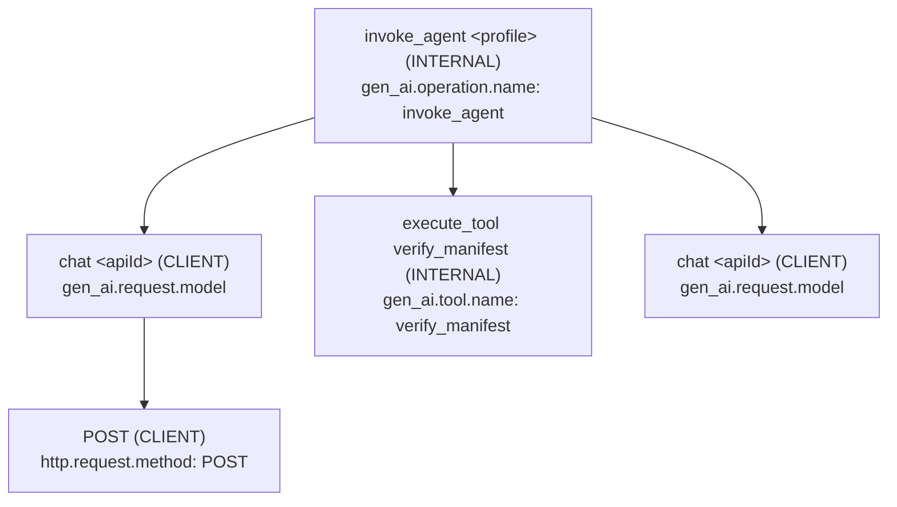
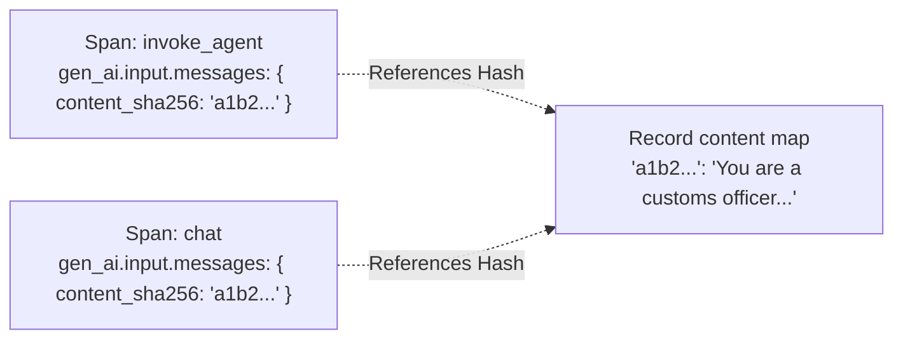

Generative agent workflows present unique observability challenges: model calls generate variable-length streaming tokens, tool invocations execute multi-step nested pipelines, and prompts repeatedly serialize large document attachments and conversation histories. Emitting naive OpenTelemetry traces for every turn leads to excessive network overhead and duplicate payload storage.

Theorem builds tracing into the kernel:
1. **Semantic conventions**: Attribute names follow a pinned version of the OpenTelemetry (OTel) Generative AI semantic conventions (`gen_ai.*`). The record names it in `schemaUrl`. For Phoenix, `withOpenInference` from `@theoremjs/agents/observability/openinference` copies OpenInference names (`openinference.span.kind`) beside them.
2. **Content interning**: Scrubbed text is hashed with SHA-256 and stored once in the record's `content` map. Spans refer to the text by its hash, so a long prompt is not repeated in every span.
3. **W3C context propagation**: A request can carry a W3C `traceparent`, so a turn joins the host's distributed trace.

## Span Hierarchy & Topology

A turn writes a tree of spans. The model calls and tool calls are children of the root. Each HTTP attempt is a child of its model call:



### Span Types (`TraceSpanType`)

Theorem names ten span types. Nine are spans Theorem writes. The tenth, `host`, is a span the host records itself:

| Span Type | Span Name Pattern | Span Kind | Role |
| :--- | :--- | :--- | :--- |
| **`turn`** | `invoke_agent <profile>` | `INTERNAL` | One exchange: the model calls and tool calls it took to answer (`runTurn`). |
| **`session`** | `invoke_agent <profile>` | `INTERNAL` | A Live session, from setup to close (`runSession`). |
| **`call`** | `chat <apiId>` in a turn, `embed <apiId>` for embeddings | `CLIENT` | One request to a model and its answer. |
| **`response`** | `generate_content <apiId>` | `CLIENT` | One spoken response in a Live session. |
| **`tool`** | `execute_tool <tool>` | `INTERNAL` | One tool call Theorem ran, from its hooks to settlement. |
| **`http`** | the HTTP method, such as `POST` | `CLIENT` | One HTTP attempt of a model call. |
| **`cutout`** | `cutout` | `CLIENT` | A side effect the host recorded after the turn. |
| **`decision`** | `decide <apiId>` | `CLIENT` | One typed decision over JSON state (`runDecision`). |
| **`evaluation`** | `theorem.eval.trial` or `theorem.eval.run` | `INTERNAL` | An eval graded this trace, or a suite ran. |
| **`host`** | any other name | the host's choice | A step the host recorded itself. |

## Semantic Attribute Catalog

Spans carry attributes named by the OpenTelemetry GenAI conventions, beside Theorem's own `theorem.*` attributes.

### 1. Model Inference (`call`)
* **`gen_ai.operation.name`**: What the span did: `invoke_agent`, `chat`, `generate_content`, `execute_tool`, `decide` or `embeddings`.
* **`gen_ai.request.model`**: The model id sent to the provider.
* **`gen_ai.provider.name`**: Who served the call. A local server appears by its declared name. Absent when unknown.
* **`gen_ai.usage.input_tokens`**: Tokens the model read.
* **`gen_ai.usage.output_tokens`**: Tokens the model wrote.
* **`gen_ai.usage.reasoning.output_tokens`**: Output tokens spent thinking.
* **`theorem.usage.cost_usd`**: The cost as the provider reported it, or Jev's fixed price for a decision. Absent when no call reported a cost.

### 2. Tool Calls (`tool`)
* **`gen_ai.tool.name`**: The tool called.
* **`gen_ai.tool.call.id`**: The call's id.
* **`theorem.tool.origin`**: Where the tool runs, which sets how far its result is trusted: `local`, `builtin`, `http`, `mcp` or `delegated`.
* **`theorem.tool.permission`**: The tool's permission tier: `auto`, `session_consent` or `always_confirm`.
* **`theorem.tool.outcome`**: How the call settled:
  * `ok`: The tool ran and returned a result.
  * `error`: The tool ran and failed, or could not run.
  * `denied`: A guardrail, a hook, or the user refused the call.
  * `gated`: The call needs confirmation, permission, or sign-in; it has not run.
  * `paused`: The call was handed back to the host to finish.
  * `cancelled`: The turn was stopped before the call settled.

### 3. Agent Lifecycle & Terminal State (`turn`)
* **`gen_ai.conversation.id`**: The conversation id the host passed (`conversationId`). Absent when it passed none.
* **`gen_ai.agent.name`**: The profile that ran.
* **`theorem.stop.kind`**: Why the turn stopped:
  * `completed`: The model finished its answer.
  * `length`: The model stopped at its output token limit.
  * `tool`: Stopped to hand a tool call back to the host. Deprecated: approval now stops as `gate`.
  * `gate`: A tool call needs confirmation, permission, or sign-in before it runs; the host resumes it.
  * `filtered`: A safety filter or the output guardrail held the answer back.
  * `provider_error`: The provider reported an error.
  * `cancelled`: The user or host stopped it.
  * `step_limit`: The last model call the profile allows asked for tools, so the turn ended without an answer.
  * `stream_incomplete`: The provider's stream ended before the answer was complete.
  * `interrupted`: The user spoke over a Live response.
  * `generation_complete`: Live only. The model finished generating this response; the turn may still be open.

## Content Interning Architecture

Exporters that copy every prompt and JSON argument into every span make traces very large.

Theorem stores each trace as a `TraceRecord`:

```text
export interface TraceRecord {
	v: 3;                                // TRACE_VERSION
	schemaUrl: string;                   // The pinned OTel GenAI semantic conventions
	resource: TraceAttributes;           // observability.resource, e.g. service.name
	metadata?: Record<string, unknown>;  // Host metadata from the request, untouched
	spans: TraceSpan[];                  // Root first, then in start order
	content: Record<string, string>;     // sha256 hex -> exact scrubbed text
}
```



When the record is built:
1. The text is scrubbed as the profile's `observability.scrub` says, with the patterns its detectors declare.
2. The scrubbed text is hashed with SHA-256.
3. The text is stored once, at `record.content[hash]`.
4. Spans carry only `{ content_sha256: hash }` references.

`toOtlpJson` puts the content back inline when it exports a record, so OpenTelemetry backends and Phoenix see the full text. `inlineContent(record, value)` does the same for one value.

## Distributed Context & Span Links

### W3C Context Propagation
To join a turn to a distributed trace, set the W3C `traceparent` of the host's span on the request:

```ts frame=request
traceparent: '00-4bf92f3577b34da6a3ce929d0e0e4736-00f067aa0ba902b7-01',
input: { text: 'Verify manifest for vessel Northern Star.' },
```

* The root `invoke_agent` span becomes a child of that span. Without a `traceparent`, the turn starts a new trace.
* A malformed `traceparent` throws.
* A traced tool call gets the W3C `traceparent` of its `execute_tool` span as `ctx.traceparent`. A tool parents its own outbound spans on it.

### Span Links (`TraceSpanLink`)
When one turn follows another, the host passes `links` on the request. Each link names the earlier root's `traceparent` (its terminal `done.traceparent`) and a kind:

| Link Kind | Trigger Condition |
| :--- | :--- |
| **`resume`** | The turn picks up a call that stopped for approval. |
| **`continue`** | The turn continues an answer that stopped early (`continueFrom`). |
| **`retry`** | The turn runs a failed turn again. |
| **`trial`** | Written by evals: links a graded trial to its eval run. |

## Related Guides

* **[Telemetry Sinks & Exporters](/docs/observability/destinations)**: Configuring profile observability, destination registries, and OTLP exporters.
* **[Evaluations & Benchmarks](/docs/observability/evals)**: Running automated benchmark suites and grading trial traces.
* **[The Five Boundaries](/docs/guardrails)**: Where guardrails read text: inbound text, tool arguments, tool results, what a tool shows the person, and the model's reply.
* **[Turn Resumption & Steering](/docs/profiles/resumption)**: Causal span links for gated turns, resumption, and continue tokens.
