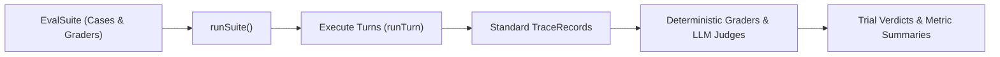

Evaluating generative agents requires testing non-deterministic behavior across probabilistic model generations, multi-step tool call sequences, and adversarial safety boundaries. Ad-hoc testing scripts that inspect raw string replies fail to capture tool side effects, token costs, or guardrail decisions.

Theorem provides a native evaluation framework built on a foundational architectural invariant: **graders inspect standardized trace records (`TraceRecord`) and nothing else**.



Because evaluations grade the trace rather than custom runner hooks:
1. **Decoupled Verification**: Any execution that produces a standard trace record (live runs, on-disk logs, or synthetic tests) can be evaluated identically.
2. **Observability Completeness**: If a grader requires a fact the trace does not capture, the trace contract is incomplete, not the grader.

## Suite Architecture (`EvalSuite` & `EvalCase`)

A suite names the profile under test, a cases file, how many trials to run, and the graders. Evals have their own entry point, `@theoremjs/agents/evals`. A suite is a module whose default export is the `EvalSuite`:

```ts
import { answer, budget, type EvalSuite, toolTrajectory } from '@theoremjs/agents/evals';

const suite: EvalSuite = {
	id: 'research-scout-v1',
	profile: 'research.scout',
	mode: 'turn', // 'turn' | 'session'
	cases: './research-scout.cases.jsonl', // Read from beside this module
	trials: {
		repeat: 3, // Trials per case
		pass: 'all', // 'all' (pass^k) | 'any' (pass@k) | { atLeast: 2 }
	},
	graders: [answer(), toolTrajectory({ mode: 'in_order' }), budget({ maxCostUsd: 0.05 })],
};

export default suite;
```

The cases file is JSON Lines: one `EvalCase` per line. Each line is checked when the suite loads. A line that is not valid, or a case id that repeats, throws a `config` error.

```text
{"id":"find-long-context-dataset","kind":"capability","difficulty":2,"input":{"text":"Find a dataset that tests long context memory, and quote its card."},"expect":{"tools":["search_datasets","read_dataset_card"],"answer":{"accepted":["LongBench"],"rejected":["all-MiniLM-L6-v2"]}}}
```

* **`kind`**: `capability` probes what the profile can do. `regression` guards what it already did.
* **`difficulty`**: from `1` to `5`.
* **`input`**: one turn (`text`, `attachments`), or a session of steps (`session.steps`).
* **`expect`**: what graders compare against: `tools`, `json`, `transcription` or `answer`.

### Multi-Trial Repetition (`trials.repeat`)
One trial (`repeat: 1`) cannot tell model noise from a real change. `repeat` has no default: it is a cost decision, so the suite states it. The pass rule says how many trials of a case must pass. Without one, the rule is `'all'`.
* **`'all'`** ($pass^k$): Every trial must pass for the case to pass. Measures consistency.
* **`'any'`** ($pass@k$): At least one trial must pass. Measures what the model can do.
* **`{ atLeast: n }`**: At least $n$ trials must pass.

## Grader Taxonomy

A grader reads a completed `Trial` and returns an `EvalResult`: a score, a label, an explanation and whether it passed.

### 1. Code Graders (Deterministic)

Code graders read the trace without calling a model:

```ts
import {
	answer,
	budget,
	type EvalGrader,
	guardrail,
	stopKind,
	toolTrajectory,
} from '@theoremjs/agents/evals';

export const graders: EvalGrader[] = [
	// The reply names an accepted answer from the case's expect.answer
	answer(),
	// The tools the turn called, in this exact order
	toolTrajectory({
		mode: 'exact', // 'exact' | 'in_order' | 'any_order' | 'subset'
		expect: ['search_datasets', 'read_dataset_card'],
	}),
	// A guardrail blocked something in the turn
	guardrail({ fired: true, action: 'block' }),
	// Cost and token ceilings
	budget({ maxCostUsd: 0.05, maxTokens: 4000 }),
	// The turn stopped with a final answer
	stopKind('completed'),
];
```

* **`answer`** reads the case's `expect.answer`. Only an `accepted` name passes. A `partial` name is close but fails. A `rejected` name next to an accepted one makes the reply `partial`. With `from`, it compares a JSON key or a tool argument instead of the reply text.
* **`toolTrajectory`** without `expect` reads the case's `expect.tools`. `in_order` lets other tools come between. `subset` means no unexpected tool, though some expected ones may be missing.
* **`budget`** also takes `maxSteps`, `maxDurationMs` and `maxTimeToFirstChunkMs`. A ceiling the trace has no reading for fails.

### 2. Model Judges (LLM-as-a-Judge)

For qualities like helpfulness, tone or correctness, `judge` asks a judge profile to grade the trial against a rubric:

```ts
import { judge, rubrics } from '@theoremjs/agents/evals';

export const correctness = judge({
	rubric: rubrics.correctness,
	profile: 'harbor.judge',
});
```

* `rubrics` holds the built-in rubrics, by camelCase name (`rubrics.toolSelection`). Make your own with `rubric({ name, labels, template })`.
* The judge profile comes from `profile`, or else from the suite's `judge.profile`. It is a text profile with `outputs.structured` set to `'evalJudgment'` (`EVAL_JUDGMENT`), or a decision profile.
* A turn that failed or delivered nothing is not judged. A setup error throws when the grader is made or first used.

When the run gives the judge the trial's W3C `traceparent`, each judge call runs under the trial's span. The judge's records then land in the judged trace, beneath the trial. Without it, each judge call starts a trace of its own.

## Running Benchmark Suites

Load the suite module with `loadSuite`, then run it with `runSuite`:

```ts
import { loadSuite, runSuite, summarizeRun } from '@theoremjs/agents/evals';

const loaded = await loadSuite('./evals/research-scout.eval.ts');

// Run every case and trial against the live provider the suite module exports
const run = await runSuite(loaded, {
	...(loaded.provider ? { provider: loaded.provider } : {}),
	concurrency: 4, // Trials in flight at once
});

// Verdicts, cost, and each trial's results
const summary = summarizeRun(run);

console.log(`Suite ${summary.suite}: ${summary.passed ? 'PASSED' : 'FAILED'}`);
console.log(`Total Spend: $${summary.costUsd.toFixed(4)}`);
```

* A live run needs a `provider`. `loadSuite` reads it from the suite module's `provider` export. Without one, `runSuite` throws a `config` error.
* Pass `recorded` (trace records, for example from `readTraceRecords`) to grade earlier runs instead of running the profile.
* `maxCostUsd` stops new trials once the run's cost passes the ceiling. `repeat` overrides the suite's `trials.repeat`.

Trial and run results are trace records too. Pass a `sink` to write them to any trace destination.

## Related Guides

* **[Command-Line Evals & Testing](/docs/observability/cli)**: Running eval suites, stress matrices, and cassette grading from the `agents` binary.
* **[Trace Spans & Semantic Conventions](/docs/observability)**: The pure trace record schema (`TraceRecord`) inspected by graders.
* **[Telemetry Sinks & Exporters](/docs/observability/destinations)**: Exporting evaluation run records to external dashboards and JSONL sinks.
* **[Profiles & Modalities](/docs/profiles)**: Defining target agent profiles and model bindings evaluated by test suites.
* **[Guardrails & Boundaries](/docs/guardrails)**: Safety boundaries verified by deterministic guardrail graders.
