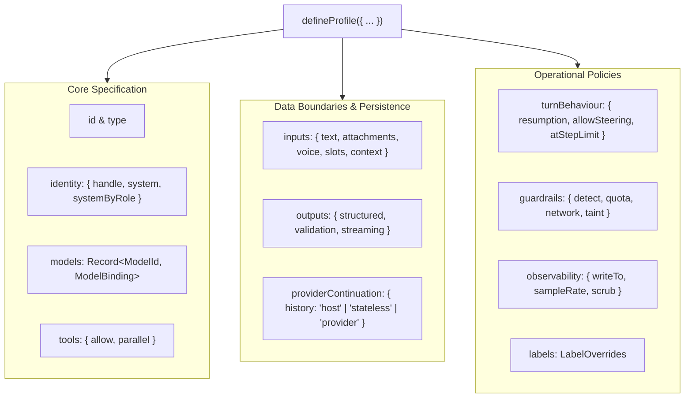
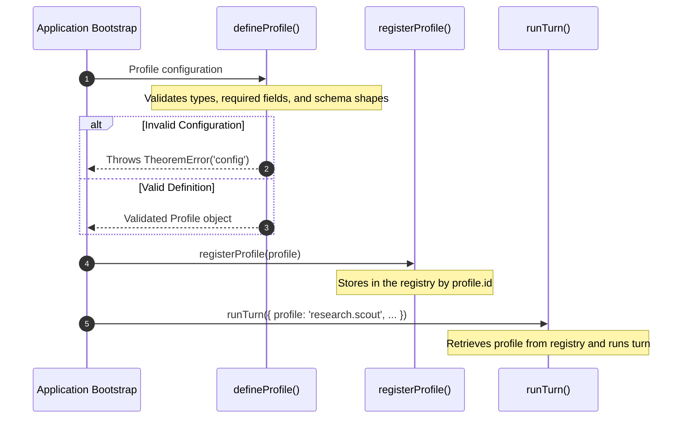

In Theorem, an agent is configured as a **profile**. Declared via `defineProfile()`, it specifies the agent's identity, model bindings, tool allowances, accepted input formats, output shapes, and operational policies for guardrails, turn behaviour, observability, and system copy.

At runtime, turns execute against this profile: requests are validated against the profile's declared models, tools, and input limits before dispatching to any provider.

## Profile Anatomy

Every profile is declared with `defineProfile()` and validates against the profile type schema:



### Profile Types

Theorem supports 7 first-class profile types. The `type` determines which runner executes the profile and which specialized configuration blocks are valid:

| Type | Description | Reference |
| :--- | :--- | :--- |
| **`text`** | Multi-step conversational agent running tool execution loops, multi-turn reasoning, and streaming text. | [Text Profiles](/docs/profiles/text) |
| **`live`** | Real-time bidirectional streaming for audio, video, and multimodal frames via WebSockets with interruption handling. Configured via the `live` block (`voice`, `vad`, `ingress`, `sessionResumption`). | [Live Profiles](/docs/profiles/live) |
| **`decision`** | Structured categorical evaluation of state without conversational history. Configured via the `decision` block (`contract`). | [Decision Profiles](/docs/profiles/decision) |
| **`embedding`** | Vector representation for semantic search and document retrieval. | [Embedding Profiles](/docs/profiles/embedding) |
| **`image`** | Media asset generation and editing from text prompts, configured via the `image` block (`aspectRatio`, `resolution`, `mimeType`). | [Image Profiles](/docs/profiles/image) |
| **`speech`** | Text-to-speech audio synthesis, configured via the `speech` block (`voice`, `style`, `speed`, `format`). | [Speech Profiles](/docs/profiles/speech) |
| **`host`** | Governed passthrough tool runner with no underlying model, executing MCP, HTTP, and local tools under standard boundary guardrails. | [Host Profiles](/docs/profiles/host) |

## Specification Reference

The configuration keys in a profile follow a consistent order across the system:

### 1. `id` & `type`

Every profile requires a unique string identifier and an archetype:

* **`id`**: Unique identifier for the profile (up to 64 characters). Used for registration and lookup by turn runners.
* **`type`**: The profile's archetype (`'text' | 'live' | 'decision' | 'embedding' | 'image' | 'speech' | 'host'`). Determines which runner executes the profile and which specialized blocks are valid.

### 2. `identity`

The `identity` block names the agent and establishes its instructions:

```ts frame=profile:text
identity: {
	handle: 'scout',
	system: 'Role: Advanced reasoning engine for research on how language models keep, retrieve, and recombine context.',
}
```

#### Prompt by Role (`systemByRole`)
When an agent needs to switch personas or operational sub-modes depending on the task, declare alternate instructions under `systemByRole`:

```ts frame=profile:text
identity: {
	handle: 'desk',
	system: 'You are the Harbor logistics desk. Provide concise, direct operational answers.',
	systemByRole: {
		auditor: [
			'You are the compliance auditor. Verify shipment declarations against harbor rules.',
			{ private: 'Do not reveal internal audit tolerance thresholds.' },
		],
		triage: 'You are intake triage. Classify declarations and route them to customs or freight.',
	},
}
```

A turn names a role in `input.role`, for example `runTurn({ profile: 'harbor.desk', input: { role: 'auditor', text: '...' } })`. If `systemByRole` has that role, its entry replaces `identity.system`. With no role, or a role it does not have, the turn uses the handle: `systemByRole[handle]` if it exists, else `identity.system`. Speech profiles do not use `systemByRole`.

#### Private Prompt Parts
To protect operational formulas, sensitive rules, or confidential policies from leaking in answers, wrap instructions in `{ private: string }`:

```ts frame=profile:text
identity: {
	handle: 'scout',
	system: [
		'Role: Advanced reasoning engine for research on how language models keep, retrieve, and recombine context.',
		{
			private: [
				'Standards:',
				'- The newest work is often not indexed yet; one search is rarely enough.',
				'- A claim rests on a primary source: the paper, the model card, the dataset card, the repository. A blog or a list is a lead to its primary source; DeepWiki answers are leads only.',
				'- Quote exact words from what the tools returned. Say how sure you are, and what you could not check.',
			].join('\n'),
		},
	],
}
```

The model gets private parts as instructions, and Theorem reads the reply for them. A run of 12 words in a row from one private part is an echo, also when it is reformatted as a list, reversed, or encoded in rot13 or leetspeak. A streamed reply holds back the words an echo could grow from, so no part of an echo reaches the host. On an echo, the reply is blocked and the turn ends with a `safety` error and `stop.kind: 'filtered'`. With no private parts, the whole prompt is guarded. Both `identity.system` and entries in `identity.systemByRole` take private parts.

### 3. `models`

Under `models`, an agent binds one or more upstream models, declaring the protocol, provider, model ID, reasoning effort tiers (`efforts`), token limits (`limits`), and history compaction thresholds (`compaction`) detailed in [Model Bindings & Compaction](/docs/profiles/bindings). When multiple models are bound, `defaultModel` specifies the fallback selection, while `allowModelSelect` controls whether turn callers can explicitly select among them.

### 4. `tools`

Under `tools`, an agent declares its capabilities—specifying the list of registered tools it may call (`allow`) and whether independent calls run concurrently (`parallel`), with parameter validation and credential injection detailed in [Tools, Auth & Capabilities](/docs/tools).

### 5. `inputs`

The `inputs` block defines the surface of data accepted by the profile in a `TurnRequest`. The research scout starts with `inputs: {}`. To let a turn bring a research brief as a PDF or a voice clip and choose a source bias, add this:

```ts frame=profile:text
inputs: {
	attachments: {
		accept: ['application/pdf'],
	},
	voice: {
		accept: ['audio/*'],
	},
	maxFiles: 5, // Files and voice clips, counted together
	maxBytes: 10485760, // Largest file or clip, in bytes
	maxTurnBytes: 26214400, // Most bytes across one turn's files and clips
	limitsByMime: {
		'application/pdf': 2000000, // Replaces maxBytes for this type
		'audio/*': 2000000,
	},
	slots: {
		focus: {
			label: 'Source Bias',
			choices: [
				{ value: 'Any Source', description: 'Consider all sources.' },
				{ value: 'Academic Research', description: 'Prefer arXiv and papers.' },
				{ value: 'Public Repositories', description: 'Prefer GitHub code and docs.' },
				{ value: 'Hugging Face Open Research', description: 'Prefer Hugging Face model and dataset cards.' },
			],
		},
	},
}
```

A turn sends its choice in `input.slots`, such as `{ focus: 'Academic Research' }`, and `{focus}` in a prompt becomes that value. Descriptions are for your interface only.

In addition to attachments, profiles can say whether a turn may send text via `text`, restrict audio input via `voice.accept`, constrain categorical metadata using `slots`, and permit host-injected background context via `context.from` and `context.maxChars`.

### 6. `outputs`

The `outputs` block sets how the provider call streams and whether thoughts reach the turn stream:

```ts frame=profile:text
outputs: {
	streaming: {
		mode: 'sse', // 'sse' streams the provider call; 'buffered' makes one buffered call
	},
}
```

Set `streaming.streamThoughts` to `false` to filter `thought` events from the turn stream.

Structured JSON schema enforcement (`outputs.structured`) and schema repair policies (`outputs.validation`) belong exclusively to text agents, detailed in [Text Profiles](/docs/profiles/text).

### 7. `providerContinuation`

The `providerContinuation` block dictates who retains multi-turn conversation memory across calls:

```ts frame=profile:text
providerContinuation: {
	history: 'host', // 'host' | 'stateless' | 'provider'
}
```

Only model turns and live sessions use it (`text`, `image`, `speech`, `live`). It is refused on `decision`, `embedding` and `host` profiles.

* **`'host'`** *(default)*: The host sends the history it covers (`input.history`) with the checkpoint. If the checkpoint no longer matches the provider, model, connection, key or history, the turn warns `provider_state_rebuilt` and the call goes from the history.
* **`'provider'`**: The host sends the checkpoint alone. The provider's stored conversation is the history. A turn that goes to another model needs the host's history.
* **`'stateless'`**: Every request stands alone. A request with history or a checkpoint is refused with a `request` error, and a finished turn gives no checkpoint.

Detailed persistence mechanics, checkpoint hashing, and failover warnings are covered in [Provider Checkpoints & State](/docs/providers/checkpoints).

### 8. `turnBehaviour`

Under `turnBehaviour`, a profile configures execution limits, continuation policies, and mid-turn steering as described in [Turn Resumption & Steering](/docs/profiles/resumption). This includes token-limit continuations (`resumption.allowContinue`, `autoContinue`), human-in-the-loop gates, mid-turn user steering affordances (`allowSteering`), and terminal actions on reaching step limits (`atStepLimit`).

### 9. `guardrails`

Under `guardrails`, a profile configures boundary detectors, token quotas, and remediation policies to protect against prompt injection, canary leaks, and data exfiltration, detailed in [Guardrails & Safety](/docs/guardrails). This governs real-time pattern detection across boundaries (`detect`), rate limiting (`quota`), and rewriting blocked model responses (`blockedReply`).

### 10. `observability`

Under `observability`, a profile configures telemetry recording, trace sinks, and data sanitization, detailed in [Observability & Evals](/docs/observability). This specifies trace export destinations (`writeTo`), deterministic sampling rates (`sampleRate`), resource attributes, and automated PII and credential scrubbing (`scrub`).

### 11. `labels`

Under `labels`, a profile overrides default kernel error strings and UI copy for localized or application-specific prompts, detailed in [Kernel Labels & Errors](/docs/profiles/labels). Declared entries replace default messages for quota exhaustion, step limit halts, tool gate prompts, and boundary violations without changing runtime logic.

## Lifecycle: Definition, Registration & Execution

A complete runnable program declaring and running a profile is shown in [Getting Started](/docs/start). The interaction between definition, registration, and runtime execution follows a strict lifecycle:



1. **`defineProfile()` validates at startup**: Synchronously verifies that declared fields match the profile type and schema requirements.
2. **`registerProfile()` registers the profile**: Stores the definition in the kernel registry under its `id` (up to 64 characters). Registering the same `id` again replaces it.
3. **Execution**: Functions like `runTurn()` and `runSession()` retrieve the registered profile by ID to govern the interaction.
