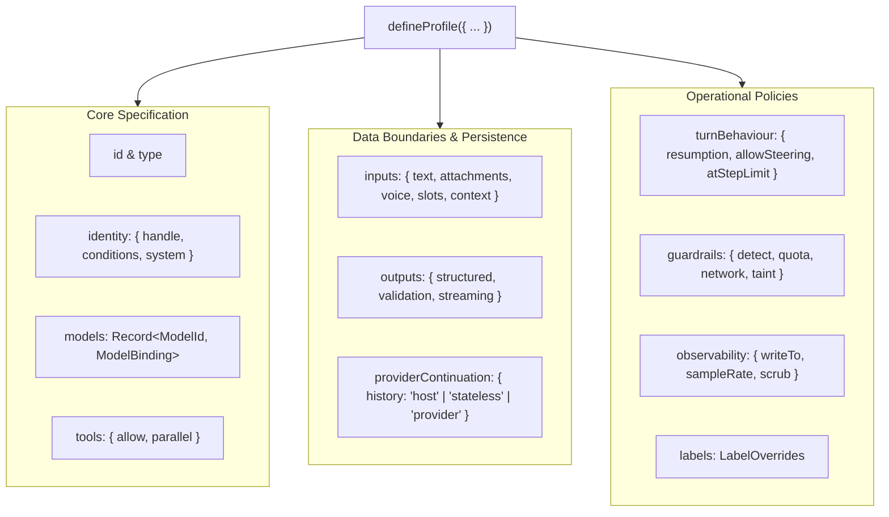
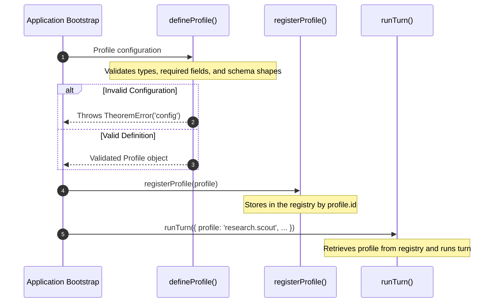

In Theorem, an agent is configured as a **profile**. Declared via `defineProfile()`, it specifies the agent's identity, model bindings, tool allowances, accepted input formats, output shapes, and operational policies for guardrails, turn behaviour, observability, and system copy.

At runtime, turns execute against this profile: requests are validated against the profile's declared models, tools, and input limits before dispatching to any provider.

## Profile Anatomy

Every profile is declared with `defineProfile()` and validates against the profile type schema:



### Profile Types

Theorem supports 8 first-class profile types. The `type` determines which runner executes the profile and which specialized configuration blocks are valid:

| Type | Description | Reference |
| :--- | :--- | :--- |
| **`text`** | Multi-step conversational agent running tool execution loops, multi-turn reasoning, and streaming text. | [Text Profiles](/docs/profiles/text) |
| **`live`** | Real-time bidirectional streaming for audio, video, and multimodal frames via WebSockets with interruption handling. Configured via the `live` block (`voice`, `vad`, `ingress`, `sessionResumption`). | [Live Profiles](/docs/profiles/live) |
| **`decision`** | Structured categorical evaluation of state without conversational history. Configured via the `decision` block (`contract`). | [Decision Profiles](/docs/profiles/decision) |
| **`embedding`** | Vector representation for semantic search and document retrieval. | [Embedding Profiles](/docs/profiles/embedding) |
| **`image`** | Media asset generation and editing from text prompts, configured via the `image` block (`aspectRatio`, `resolution`, `mimeType`). | [Image Profiles](/docs/profiles/image) |
| **`speech`** | Text-to-speech audio synthesis, configured via the `speech` block (`voice`, `style`, `speed`, `format`). | [Speech Profiles](/docs/profiles/speech) |
| **`transcription`** | Speech to text: one voice clip in, the words out as text. | [Transcription Profiles](/docs/profiles/transcription) |
| **`host`** | Your code is the orchestrator. It names each MCP, HTTP or function tool and its input, and Theorem runs the call under the same permissions and traces as any agent, guarded by `detect` and `network`. | [Host Profiles](/docs/profiles/host) |

## Specification Reference

The configuration keys in a profile follow a consistent order across the system:

### 1. `id` & `type`

Every profile requires a unique string identifier and an archetype:

* **`id`**: Unique identifier for the profile (up to 64 characters). Used for registration and lookup by turn runners.
* **`type`**: The profile's archetype (`'text' | 'live' | 'decision' | 'embedding' | 'image' | 'speech' | 'transcription' | 'host'`). Determines which runner executes the profile and which specialized blocks are valid.

### 2. `identity`

The `identity` block names the agent and establishes its instructions:

```ts frame=profile:text
identity: {
	handle: 'scout',
	system: 'Role: Advanced reasoning engine for research on how language models keep, retrieve, and recombine context.',
}
```

#### Prompt Lines (`conditions`)
Prompt lines let one agent speak differently by plan or by channel. Declare the facts a turn states under `conditions`, and write each instruction as one line. The scout declares no conditions. To add them:

```ts frame=profile:text
identity: {
	handle: 'scout',
	conditions: { path: ['web', 'imessage'], plan: ['free', 'paid'] },
	system: [
		// ...
		'when plan is free: Keep the reply to one paragraph.',
		'when path is imessage and plan is paid: Write plain text with no lists.',
	],
}
```

A line that opens with `when` goes only on turns where it fits. Every line that fits is sent, a blank line apart. A `when` uses the same words as an activity label: `is`, `is not`, and `and`.

A turn can leave a slot unset. Then `when reader is student` does not fit and `when reader is not student` fits. A fact that every turn must state belongs in a condition.

Each turn states every condition, with a value the profile lists. A condition named `path` reads the turn's own `path`, and the rest go in `conditions`:

```ts frame=statements
const events = runTurn({
	profile: 'research.scout',
	path: 'web',
	conditions: { plan: 'free' },
	// ...
});
```

A turn that leaves a condition out, gives a value the profile does not list, or names a condition the profile does not declare, is refused with a `request` error. A condition chooses lines and never fills text: only a slot fills `{name}`. Text, image and live profiles take conditions.

#### Lines for a Reader
A `when` line can also read a slot, which is how one prompt fits different people. The scout's `reader` slot says who it writes for, and two lines read it:

```ts frame=profile:text
identity: {
	handle: 'scout',
	system: [
		// ...
		'when reader is reviewer: The reader reviews papers. Lead with weak evidence and what would refute a claim.',
		'when reader is student: The reader is learning the field. Define each term the first time you use it.',
	],
},
// ...
inputs: {
	slots: {
		reader: {
			label: 'Reader',
			choices: [{ value: 'anyone' }, { value: 'reviewer' }, { value: 'student' }],
		},
	},
},
// ...
```

A turn chooses in `input.slots`, for example `runTurn({ profile: 'research.scout', input: { slots: { reader: 'reviewer' }, text: '...' } })`. The fitting line joins the rest of the prompt, so a reviewer still gets the scout's whole prompt. With `anyone`, neither line fits. A turn with a line that reads a slot must choose that slot.

#### Private Prompt Parts
To protect operational formulas, sensitive rules, or confidential policies from leaking in answers, wrap instructions in `{ private: string }`. A prompt line is a string or a list of parts, so a private part goes inside a line's list. A bare `{ private }` entry in `system` is refused. The scout's prompt opens with one line of two parts:

```ts frame=profile:text
identity: {
	handle: 'scout',
	system: [
		[
			'Role: Advanced reasoning engine for research on how language models keep, retrieve, and recombine context.',
			{
				private: [
					'Standards:',
					'- The newest work is often not indexed yet; one search is rarely enough.',
					// ...
				].join('\n'),
			},
		],
		// ...
	],
}
```

The model gets private parts as instructions, and Theorem reads the reply for them. A run of 12 words in a row from one private part is an echo, also when it is reformatted as a list, reversed, or encoded in rot13 or leetspeak. A streamed reply holds back the words an echo could grow from, so no part of an echo reaches the host. On an echo, the reply is blocked and the turn ends with a `safety` error and `stop.kind: 'filtered'`. Once one part is private, the plain strings beside it are shareable. With no private parts, the whole prompt is guarded.

### 3. `models`

Under `models`, an agent binds one or more upstream models, declaring the protocol, provider, model ID, reasoning effort tiers (`efforts`), token limits (`limits`), and history compaction thresholds (`compaction`) detailed in [Model Bindings & Compaction](/docs/profiles/bindings). When multiple models are bound, `defaultModel` specifies the fallback selection, while `allowModelSelect` controls whether turn callers can explicitly select among them.

### 4. `tools`

Under `tools`, an agent declares its capabilities—specifying the list of registered tools it may call (`allow`) and whether independent calls run concurrently (`parallel`), with parameter validation and credential injection detailed in [Tools, Auth & Capabilities](/docs/tools).

### 5. `inputs`

The `inputs` block defines the surface of data accepted by the profile in a `TurnRequest`. The research scout's `focus` slot says where a turn looks first. To let a turn bring a research brief as a PDF or a voice clip and choose a source bias, change `inputs` to this:

```ts frame=profile:text
inputs: {
	attachments: {
		accept: ['application/pdf'],
	},
	voice: {
		accept: ['audio/*'],
	},
	maxFiles: 5, // Files and voice clips, counted together
	maxBytes: 10485760, // Largest file or clip, in bytes
	maxTurnBytes: 26214400, // Most bytes across one turn's files and clips
	limitsByMime: {
		'application/pdf': 2000000, // Replaces maxBytes for this type
		'audio/*': 2000000,
	},
	slots: {
		focus: {
			label: 'Focus',
			choices: [
				{ value: 'Hugging Face Open Research' },
				{ value: 'arXiv' },
				{ value: 'GitHub' },
				{ value: 'Anywhere' },
			],
		},
	},
}
```

A turn sends its choice in `input.slots`, such as `{ focus: 'arXiv' }`, and `{focus}` in a prompt becomes that value. A turn that leaves the slot unset is refused with a `request` error when a line that goes on the turn fills it. A choice can also have a `description`, which only your interface reads.

In addition to attachments, profiles can say whether a turn may send text via `text`, restrict audio input via `voice.accept`, constrain categorical metadata using `slots`, and permit host-injected background context via `context.from` and `context.maxChars`.

### 6. `outputs`

The `outputs` block sets how the provider call streams and whether thoughts reach the turn stream:

```ts frame=profile:text
outputs: {
	streaming: {
		mode: 'sse', // 'sse' streams the provider call; 'buffered' makes one buffered call
	},
}
```

Set `streaming.streamThoughts` to `false` to filter `thought` events from the turn stream.

Structured JSON schema enforcement (`outputs.structured`) and schema repair policies (`outputs.validation`) belong exclusively to text agents, detailed in [Text Profiles](/docs/profiles/text).

### 7. `providerContinuation`

The `providerContinuation` block dictates who retains multi-turn conversation memory across calls:

```ts frame=profile:text
providerContinuation: {
	history: 'host', // 'host' | 'stateless' | 'provider'
}
```

Only model turns and live sessions use it (`text`, `image`, `speech`, `live`). It is refused on `decision`, `embedding` and `host` profiles. A `transcription` profile has none.

* **`'host'`** *(default)*: The host sends the history it covers (`input.history`) with the checkpoint. If the checkpoint no longer matches the provider, model, connection, key or history, the turn warns `provider_state_rebuilt` and the call goes from the history.
* **`'provider'`**: The host sends the checkpoint alone. The provider's stored conversation is the history. A turn that goes to another model needs the host's history.
* **`'stateless'`**: Every request stands alone. A request with history or a checkpoint is refused with a `request` error, and a finished turn gives no checkpoint.

Detailed persistence mechanics, checkpoint hashing, and failover warnings are covered in [Provider Checkpoints & State](/docs/providers/checkpoints).

### 8. `turnBehaviour`

Under `turnBehaviour`, a profile configures execution limits, continuation policies, and mid-turn steering as described in [Turn Resumption & Steering](/docs/profiles/resumption). This includes token-limit continuations (`resumption.allowContinue`, `autoContinue`), human-in-the-loop gates, mid-turn user steering affordances (`allowSteering`), and terminal actions on reaching step limits (`atStepLimit`).

### 9. `guardrails`

Under `guardrails`, a profile configures boundary detectors, token quotas, and remediation policies to protect against prompt injection, canary leaks, and data exfiltration, detailed in [Guardrails & Safety](/docs/guardrails). This governs real-time pattern detection across boundaries (`detect`), rate limiting (`quota`), and rewriting blocked model responses (`blockedReply`).

### 10. `observability`

Under `observability`, a profile configures telemetry recording, trace sinks, and data sanitization, detailed in [Observability & Evals](/docs/observability). This specifies trace export destinations (`writeTo`), deterministic sampling rates (`sampleRate`), resource attributes, and automated PII and credential scrubbing (`scrub`).

### 11. `labels`

Under `labels`, a profile overrides default kernel error strings and UI copy for localized or application-specific prompts, detailed in [Kernel Labels & Errors](/docs/profiles/labels). Declared entries replace default messages for quota exhaustion, step limit halts, tool gate prompts, and boundary violations without changing runtime logic.

## Lifecycle: Definition, Registration & Execution

A complete runnable program declaring and running a profile is shown in [Getting Started](/docs/start). The interaction between definition, registration, and runtime execution follows a strict lifecycle:



1. **`defineProfile()` validates at startup**: Synchronously verifies that declared fields match the profile type and schema requirements.
2. **`registerProfile()` registers the profile**: Stores the definition in the kernel registry under its `id` (up to 64 characters). Registering the same `id` again replaces it.
3. **Execution**: Functions like `runTurn()` and `runSession()` retrieve the registered profile by ID to govern the interaction.
