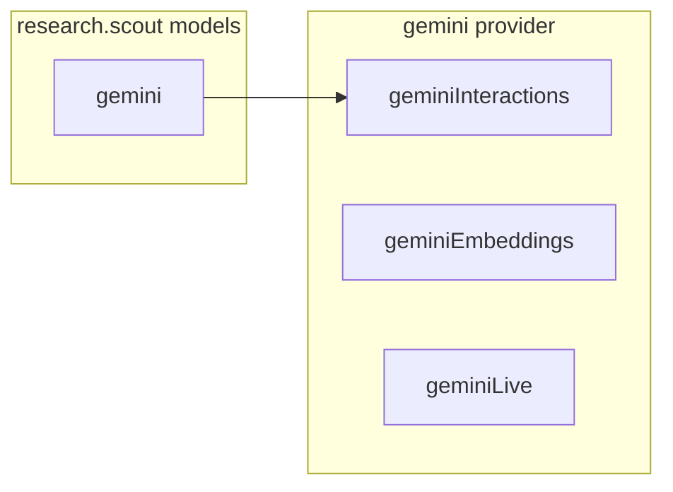

In Theorem, models are not hardcoded vendor strings. A model is declared as a **binding** that links a local identifier to an upstream protocol, a registered provider, an API model name, and execution budgets.

Because conversation histories grow over multi-turn interactions, model bindings can also declare automated history compaction thresholds, detailed in [History Compaction](/docs/profiles/compaction).

## The Model Triad: Protocol, Provider, Binding

Model execution separates into three distinct concepts:

* **Protocol**: The code that speaks one API shape, and everything on its wire, such as `openRouterOpenAi` or `geminiInteractions`.
* **Provider**: Where a service is and how to sign in to it, and the protocols it serves. Nothing in a provider can change a request or read a reply.
* **Binding**: One entry under `models`. It pairs a registered provider with one of the protocols it serves and the id the provider knows the model by.

One provider can serve several protocols. The `gemini` provider serves `geminiInteractions`, `geminiEmbeddings` and `geminiLive`. So every binding names the protocol its model speaks. When the profile is registered, Theorem checks that the provider serves that protocol and that the protocol has an endpoint for the profile's type.



## Declaring a Model Binding

Bindings are declared under `models` on the profile. This is the research scout's `open` model:

```ts frame=profile:text
models: {
	open: {
		protocol: 'openRouterOpenAi',
		provider: 'openrouter',
		apiId: 'openrouter/free',
		keySlot: 'openrouter',
	},
}
```

Add `maxOutputTokens` to a binding to set the token limit for one reply.

Bindings can also be generated using a registered provider's helper:

```ts
import { openRouterProvider, registerProvider } from '@theoremjs/agents';

const router = registerProvider(openRouterProvider, { keySlot: 'openrouter' });

export const open = router.model('openRouterOpenAi', 'openrouter/free', {
	efforts: { normal: 'medium', deep: 'high' },
	defaultEffort: 'normal',
	summaries: true,
});
```

Both forms produce the exact same validated data shape checked by `modelBindingSchema`.

## Credential Slots & The Vault

Profiles contain application architecture, not secrets. Model bindings name credential slots rather than raw API keys:

* **`keySlot`**: The slot this model's calls are signed with, in place of the provider's. Use it to bill one model to a different key. If omitted, the provider's primary slot is used.
* **`fallbackKeySlot`**: The slot tried once after a rate limit or a busy model on the primary slot, before the reply starts, and only when the vault holds a key under it. It must differ from the primary slot. If omitted, the provider's fallback slot is used, if it has one.

A binding can name a slot only when its provider takes a key.

At runtime, keys come from a **vault** passed to `runTurn()` in its second argument:

```ts frame=statements
const events = runTurn(
	{
		profile: 'research.scout',
		input: { text: 'Find papers on episodic memory for language models.' },
	},
	{
		vault: {
			openrouter: process.env.OPENROUTER_API_KEY,
		},
	},
);
for await (const event of events) {
	if (event.type === 'text') console.log(event.text);
}
```

A vault entry is a string, an object for a provider that signs in with several fields, or a resolver function that returns either, at once or as a promise, when a call needs the key. The kernel reads a slot only for the call that names it.

## Multi-Model Routing & Selection

A profile can bind more than one model. The scout binds a free OpenRouter model and a Gemini one. Each turn runs on one of them:

```ts frame=profile:text
models: {
	open: {
		protocol: 'openRouterOpenAi',
		provider: 'openrouter',
		apiId: 'openrouter/free',
		keySlot: 'openrouter',
	},
	gemini: {
		protocol: 'geminiInteractions',
		provider: 'gemini',
		apiId: 'gemini-3.8-flash',
		keySlot: 'gemini',
	},
},
defaultModel: 'open',
allowModelSelect: true,
```

* **`defaultModel`**: The model a turn gets when it does not pick one. Required when more than one model is bound. With one model, it is that model.
* **`allowModelSelect`**: When `true`, a turn can pick a model by its key (`runTurn({ profile: 'research.scout', model: 'gemini', input: { ... } })`). A key the profile does not declare is refused. When it is left out or `false`, a turn that names a model is refused with a `TheoremError`.

## Reasoning Efforts & Thinking

For reasoning models, a binding names its own efforts, and each maps to one of Theorem's thinking levels. These are the scout's efforts. To let a turn pick one, add `allowEffortSelect`:

```ts frame=profile:text
models: {
	gemini: {
		protocol: 'geminiInteractions',
		provider: 'gemini',
		apiId: 'gemini-3.8-flash',
		keySlot: 'gemini',
		efforts: {
			normal: 'medium',
			deep: 'high',
		},
		defaultEffort: 'normal',
		allowEffortSelect: true, // Add this
		summaries: true,
	},
}
```

* **`efforts`**: Maps your effort names to thinking levels: `'none' | 'minimal' | 'low' | 'medium' | 'high' | 'xhigh' | 'max'`. A provider refuses a level its model does not take.
* **`defaultEffort`**: The effort a turn gets when it does not pick one. Required when more than one effort is declared. With one effort, it is that effort.
* **`allowEffortSelect`**: Lets a turn pick an effort by name (`runTurn({ profile: 'research.scout', effort: 'deep', input: { ... } })`). It needs two or more efforts.
* **`summaries`**: Asks the model for summaries of its thinking. Not every model sends them. With some providers, `false` only hides thoughts, and others ignore it.

`defaultEffort` and `allowEffortSelect` need `efforts`.

## Execution Budgets (`limits`)

A binding can set the points at which Theorem stops its model's calls under `limits`. The scout sets none. To set them, add this:

```ts frame=profile:text
models: {
	open: {
		protocol: 'openRouterOpenAi',
		provider: 'openrouter',
		apiId: 'openrouter/free',
		limits: {
			operationTimeoutMs: 30_000, // one call, retries included
			maxWireResponseBytes: 1_000_000, // bytes the provider sends for one step
			maxStepBytes: 500_000, // bytes in all the events of one step
			maxStepEvents: 500, // events in one step
			maxPendingToolCalls: 5, // tool calls one step may ask for
		},
	},
}
```

There are nine limits. Each one left out is no limit, so the provider's own limits apply. A `limits` value passed to `runTurn()` overrides each field it sets.

| Limit | What it stops |
| :--- | :--- |
| `operationTimeoutMs` | How long one call may take, in milliseconds, retries included. |
| `connectTimeoutMs` | How long a live session may take to open, in milliseconds. |
| `liveStepTimeoutMs` | How long a live session may wait for the model to answer, in milliseconds. |
| `maxWireRecordBytes` | The most bytes in one record the provider sends: a stream event or a socket message. |
| `maxWireResponseBytes` | The most bytes the provider sends for one step. |
| `maxEventBytes` | The most bytes in one event of a step. |
| `maxStepBytes` | The most bytes in all the events of one step. |
| `maxStepEvents` | The most events in one step. |
| `maxPendingToolCalls` | The most tool calls one step may ask for. |

## Provider Built-in Tools (`builtInTools`)

Tools the provider runs itself, such as OpenRouter's `webSearch` or Gemini's `googleSearch`, are declared on the binding under `builtInTools`. Each id must be registered as a builtin tool and declared by the provider's adapter. The scout uses none. To add one:

```ts frame=profile:text
models: {
	open: {
		protocol: 'openRouterOpenAi',
		provider: 'openrouter',
		apiId: 'openrouter/free',
		builtInTools: ['webSearch'],
	},
}
```

The protocol writes each one onto the provider's request. For `webSearch`, `openRouterOpenAi` adds `web_search_options` to the request body.

A turn can pass arguments to a built-in tool with `builtInArgs`, keyed by tool id. Each id must be in the chosen model's `builtInTools`, and the provider's schema for that tool checks the value. Gemini's `googleMaps` takes a location. On a profile whose model lists `googleMaps` in `builtInTools`:

```ts frame=statements
const events = runTurn({
	profile: 'harbor.maps',
	input: { text: 'Find fuel docks near the harbour.' },
	builtInArgs: {
		googleMaps: { location: { latitude: 51.9, longitude: 4.48 } },
	},
});
```

When a turn passes none, each built-in runs with no args.

Built-in tools are not listed in `tools.allow`. That field takes your own tools only, and registering a profile that lists a builtin there fails.

## Suggested Reading

* **[History Compaction](/docs/profiles/compaction)**: How a binding shortens history that grows too long.
* **[Text Agents](/docs/profiles/text)**: How conversational text agents invoke bound models via `runTurn()`.
* **[Protocols & Defining Providers](/docs/providers/protocols)**: Implementing custom wire protocols and registering new upstream model providers.
