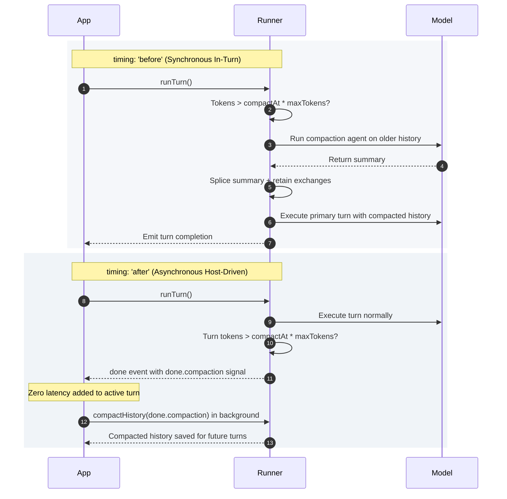

Over long-running conversations, dialogue history consumes substantial token budgets and risks exceeding model context windows. Left unmanaged, long histories degrade model reasoning and increase latency.

In Theorem, **history compaction** automatically condenses older exchanges into a structured summary while preserving recent context verbatim.

## The Compaction Specification (`compaction`)

Compaction is configured directly on a profile's model binding. Each of the scout's models hands its history to `research.compactor`, a text profile with no tools and one instruction: "Summarise the research so far. Keep every source URL, every exact quote, and every open lead." This is the `compaction` of the `open` model:

```ts frame=models
models: {
	open: {
		// ...
		compaction: {
			maxTokens: 32_000,
			compactAt: 0.75,                // Trigger when tokens exceed 24,000 (0.75 * 32,000)
			profile: 'research.compactor',  // The profile that writes the summary
			previousExchanges: 4,           // Retain the last 4 exchanges verbatim
			timing: 'before',               // Run compaction synchronously before the turn
		},
	},
}
```

### Configuration Parameters

* **`maxTokens`**: The baseline token ceiling against which compaction thresholds are evaluated.
* **`compactAt`**: Fraction of `maxTokens` (between `0` and `1`) that activates compaction. In the example above, compaction fires once tokens exceed 24,000 ($0.75 \times 32,000$).
* **`previousExchanges`**: Governs how much recent dialogue is preserved:
  * `≥ 1` (integer): Preserves the last $N$ user-assistant exchanges intact.
  * `(0, 1)` (fraction): Preserves exchanges that fit within that fraction of `maxTokens`.
  * `0`: Compacts all history; nothing is retained verbatim.
* **`meter`**: Determines how tokens are calculated:
  * `'history'` (default): Counts the tokens in the earlier conversation.
  * `'input'`: Uses the prompt tokens the provider reported for the last call, or the count the host passes in.
* **`profile`**: The text profile that writes the summary. Register it before this one. Leave it out and a text agent summarises its own history, with its own instructions and model and no tools. Other profile types must name one.
* **`trigger`**: Your function that decides when to compact: it gets `ctx` and returns, or resolves to, `true` to compact. When set, it decides alone: `compactAt` and `maxTokens` are not compared. `ctx` carries the token count and the meter it used.

## Timing: Synchronous vs Asynchronous Compaction

Theorem supports two operational timing models: in-turn synchronous execution, or out-of-band asynchronous execution.



### 1. Synchronous (`timing: 'before'`)

The kernel evaluates token counts before calling the model. If compaction is needed, it runs the compactor immediately, splices the summary into the history, and executes the turn against the fresh history.

The active turn absorbs the compactor's execution latency, and the model reads the shorter history on that same turn. During execution, Theorem emits a `compaction` lifecycle event containing the split details and the generated summary.

### 2. Asynchronous (`timing: 'after'`)

The scout compacts before the turn. To compact after it instead, set `timing: 'after'`. The turn then executes immediately without added latency. At the conclusion of the turn, the kernel checks whether compaction thresholds were crossed. If so, it attaches a compaction signal to the `done` event as its `compaction` field.

The host application reads this signal and triggers out-of-band compaction in the background:

```ts frame=statements
// Inside your turn event consumer
if (doneEvent.compaction) {
	const result = await compactHistory({
		profile: 'research.scout',
		history: currentHistory,
		tokens: doneEvent.compaction.tokens,
	});

	// undefined: there was nothing to compact
	if (result?.outcome === 'compacted') {
		// Persist result.history for subsequent turns
		await saveSessionHistory(sessionId, result.history);
	}
}
```

This model is ideal for user-facing applications where response latency is critical, shifting summarization work to background tasks between turns.

## Compaction Mechanics & Fault Tolerance

Compaction operates with deterministic rules to prevent data loss or context overflow:

1. **Exchange Splitting**: `splitForCompaction` divides messages into `toCompact` (older) and `toRetain` (recent).
2. **Tool Call Sanitization**: In `toCompact`, tool invocations and results are converted into plain text messages. The compaction agent requires no tool declarations to summarize past actions.
3. **Summary Injection**: The resulting text summary is prepended to `toRetain` with `metadata: { compactionSummary: true }`.
4. **Resilient Failure Handling**:
   * If the compactor fails and the history still fits `maxTokens`, the history is kept whole (`outcome: 'deferred'`). A later turn can try again.
   * If the compactor fails over `maxTokens`, the messages in `toCompact` are dropped (`outcome: 'dropped'`). Earlier compaction summaries among them stay. The result carries the `failure`.

## Suggested Reading

* **[Model Bindings](/docs/profiles/bindings)**: Binding upstream models, protocols, providers, and execution budgets.
* **[Text Agents](/docs/profiles/text)**: Invoking conversational agents via `runTurn()` and handling stream events.
* **[Turn Resumption & Steering](/docs/profiles/resumption)**: Managing human-in-the-loop gates, auto-continuations, and mid-turn steering affordances.
