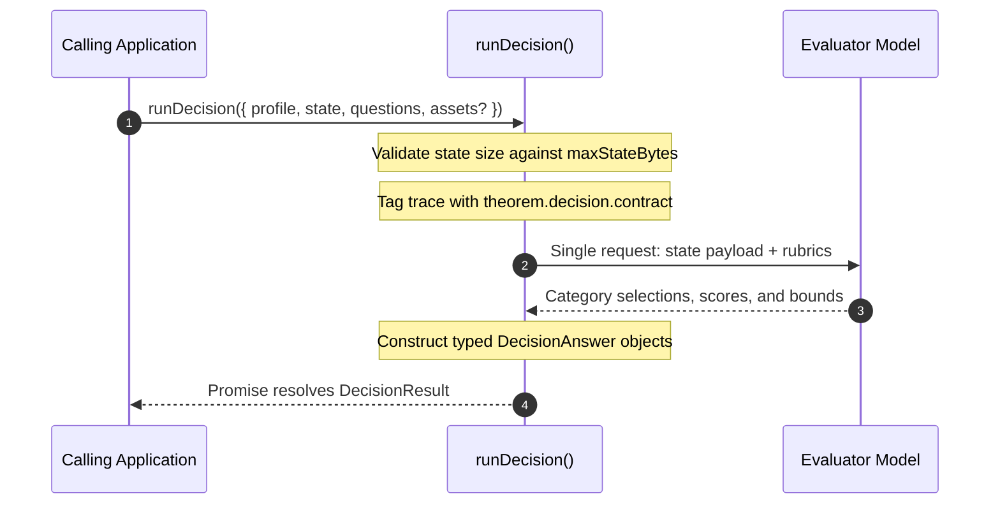
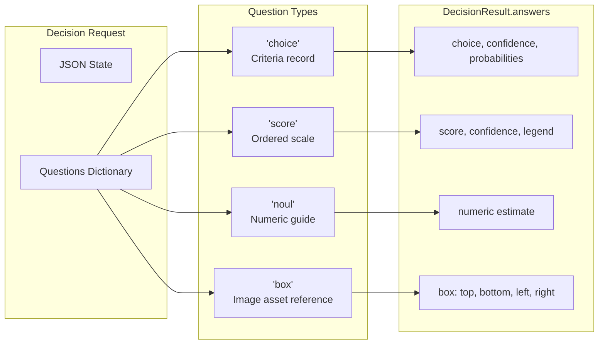

Decision profiles (`type: 'decision'`) configure stateless evaluation agents that judge structured JSON application state against rubric-based questions. They are executed through `runDecision()`, returning deterministic category selections, numerical scores, confidence probabilities, and bounding boxes in a single non-conversational call.

## Decision Profile Configuration

Base profile fields (`identity`, `guardrails`, `observability`, `labels`) apply across all modalities as documented in [Profiles](/docs/profiles). Unlike conversational text agents or live sessions, decision profiles execute no tool loops, store no conversation history, and require no system prompts. They bind exactly one model. This slice shows the two decision blocks:

```ts frame=profile:decision
inputs: {
	state: 'json',
	maxStateBytes: 256 * 1024, // 256 KB limit on the JSON state
},
decision: {
	// A host-owned id the trace records; not a schema definition
	contract: 'cargo_hazard_classification_v1',
},
```

### Architectural Invariants

* **Single Model Rule**: A decision profile declares exactly one model under `models`. It takes no `defaultModel` or `allowModelSelect`. Only a decision binding takes `timeoutMs`: how long the decision waits for its provider, in milliseconds. It replaces the binding's `limits.operationTimeoutMs`; with neither set, there is no timeout. A decision binding takes no `retry`.
* **No Tools or System Channel**: Decision profiles call no tools. Instructions are delivered strictly through question rubrics, and input data is delivered strictly through `state`.
* **Stateless Execution**: Decisions maintain no conversational history, produce no tokens across turns, and perform no history compaction.

## JSON State Inputs & Asset References

A decision evaluates arbitrary structured data provided at call time:



* **`inputs.state: 'json'`**: The payload being evaluated. State can be any JSON value except `null` (objects, arrays, strings, numbers, booleans).
* **`inputs.maxStateBytes`**: Maximum payload size in bytes. A larger state is refused with code `invalid_request` before it leaves your process.
* **`decision.contract`**: A host-defined trace label. Despite the name `contract`, this field does not define or bind a schema—the question contract is declared at invocation time in `runDecision()`. Theorem records this string on OpenTelemetry spans as `theorem.decision.contract` for trace filtering and auditing.

### Multimodal Asset References

When a decision evaluates images (e.g. photos of cargo containers or inspection tags), callers pass image data in `DecisionRequest.assets` using bracketed references like `<seal_photo>`:

```ts frame=statements
const assets = {
	'<seal_photo>': {
		mimeType: 'image/jpeg',
		data: base64JpegBytes,
	},
};
```

The model reads the image wherever its reference appears in `state` or in a question's instructions. Unreferenced assets are omitted from the request automatically.

## Question Contracts & Rubrics

Callers submit one or more structured questions in `DecisionRequest.questions`. Theorem supports 4 question types:



| Question Type | Type Key | Input Specification | Model Output (`DecisionAnswer`) |
| :--- | :--- | :--- | :--- |
| **Categorical Choice** | `'choice'` | `instructions: string`, `criteria: Record<string, string>` | `choice: string`, `confidence: number`, `probabilities: Record<string, number>` |
| **Rubric Scoring** | `'score'` | `instructions: string`, `criteria: string[]` (ordered 0 to $N$) | `score: number`, `confidence: number`, `legend: Record<string, string>`, `probabilities: Record<string, number>` |
| **Numeric Estimate** | `'noul'` | `instructions: string`, optional `criteria` guide | `noul: number` |
| **Image Bounding Box** | `'box'` | `instructions: string`, optional `image` target | `box: { top, bottom, left, right }`, `confidence: number` |

## Invoking Decisions: `runDecision()`

Decisions are executed using `runDecision(request, options)`. The options carry the key vault and transport settings, as for any provider call. The function returns a `Promise<DecisionResult>` containing the model used, token consumption, and the resolved answer for every question.

### Basic Invocation

```ts
import { runDecision } from '@theoremjs/agents';

const result = await runDecision(
	{
		profile: 'harbor.cargo_safety_decision',
		state: {
			containerId: 'CONT-9941',
			declaredWeightKg: 14200,
			flammable: true,
			sealIntact: true,
		},
		questions: {
			clearanceVerdict: {
				type: 'choice',
				instructions: 'Determine intake disposition based on container state.',
				criteria: {
					clear: 'Safe for immediate yard intake.',
					hold: 'Hold for physical inspection.',
					quarantine: 'Hazardous cargo or compromised seal requiring quarantine.',
				},
			},
			riskScore: {
				type: 'score',
				instructions: 'Score the overall intake risk from lowest to highest.',
				criteria: [
					'Routine non-hazardous cargo.',
					'Heavy non-hazardous cargo.',
					'Flammable cargo with verified intact seal.',
					'Compromised seal or unverified manifest.',
				],
			},
		},
	},
	hostOptions,
);

const verdict = result.answers.clearanceVerdict;
if (verdict.type === 'choice') {
	console.log(`Verdict: ${verdict.choice}`);
	console.log(`Confidence: ${verdict.confidence}`);
	console.log('Class probabilities:', verdict.probabilities);
}
```

### `DecisionResult` Structure

The returned `DecisionResult` provides typed answers keyed by question ID:

| Field | Type | Description |
| :--- | :--- | :--- |
| **`model`** | `string` | The resolved model ID that performed the evaluation. |
| **`answers`** | `Record<string, DecisionAnswer>` | Map of question IDs to their evaluated answers (`choice`, `score`, `noul`, or `box`). |
| **`usage`** | `object` | Reported usage: `inputTokens`, `outputTokens`, `costUsd`, and `estimated` flag. |

## Handle a Decision Error

When a decision fails, `runDecision()` throws a `DecisionError`. Import the class from `@theoremjs/agents/kernel` to test for it. Its `code` is one of `invalid_config`, `invalid_request`, `conflict`, `not_found`, `invalid_input`, `not_allowed`, `authentication`, `permission`, `rate_limited`, `busy`, `unsupported`, `unavailable`, `network`, `timeout`, `cancelled`, `malformed_response`, `refused`, `blocked`, `disclosure_blocked`, `declined`, `failed` and `internal`.

Each code reads as an error kind, which the error also carries as `kind`. When the provider answered with an HTTP status, the error carries it as `status`. Response bodies are never kept.

| Code | Kind | What went wrong |
| :--- | :--- | :--- |
| **`invalid_config`** | `config` | The profile, tool, or schema is set up wrong. |
| **`invalid_request`** | `request` | The call is wrong. For example, it names a model, its state is `null` or larger than `inputs.maxStateBytes`, it has no questions, a question has no instructions or criteria, or an asset is not PNG or JPEG base64. |
| **`conflict`** | `conflict` | The call conflicts with the state it acts on. |
| **`not_found`** | `not_found` | Something the call names by id is not there. |
| **`invalid_input`** | `input` | The input is not one the profile accepts. |
| **`not_allowed`** | `action` | The call asks for something the profile does not allow. |
| **`authentication`** | `auth` | A credential is missing or rejected, or the account cannot be billed. |
| **`permission`** | `auth` | The provider refused the credential with HTTP 403. |
| **`rate_limited`** | `rate_limit` | Too many requests, or a quota is used up. |
| **`busy`** | `busy` | The provider is up but too busy for the call. |
| **`unsupported`** | `unsupported` | The model or route cannot serve this request. |
| **`unavailable`** | `unavailable` | The provider is down. |
| **`network`** | `network` | The request never reached the provider. |
| **`timeout`** | `timeout` | The model took longer than the host allowed. |
| **`cancelled`** | `cancelled` | The request's `signal` aborted, or the host stopped the call. |
| **`malformed_response`** | `bad_response` | The provider's answer cannot be used. For example, it names no model, a value is out of range, or its probabilities do not match the criteria. |
| **`refused`** | `safety` | Theorem or the provider held the answer back. |
| **`blocked`** | `blocked` | A guardrail or host policy stopped the call. |
| **`disclosure_blocked`** | `blocked` | `guardrails.disclosure` refused to send the state to the provider. |
| **`declined`** | `declined` | The user declined the call. |
| **`failed`** | `failed` | A step ran and failed. |
| **`internal`** | `internal` | A Theorem invariant broke. |

A provider failure keeps its kind: Theorem gives it the code for that kind.

## Related Guides

* **[Profiles](/docs/profiles)**: Shared identity, registry lifecycle, and profile types.
* **[Model Bindings](/docs/profiles/bindings)**: Vault credentials, protocol definitions, and execution limits.
* **[Text Profiles](/docs/profiles/text)**: Multi-turn conversational agents with tool execution loops.
