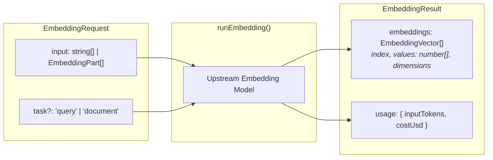

Embedding profiles (`type: 'embedding'`) configure agents that generate dense vector representations of text and media inputs for semantic search, document retrieval, and clustering. They are executed through `runEmbedding()`, returning numerical vector arrays in a single stateless request. The research cookbook's `research.embedder` ranks a search's abstracts against the question.

## Embedding Profile Configuration

Base profile fields (`identity`, `models`, `guardrails`, `observability`, `labels`) apply across all modalities as documented in [Profiles](/docs/profiles). Embedding profiles declare which inputs they accept. The embedder runs on one Gemini model. It takes text, which every embedding profile accepts unless `inputs.text` is `false`:

```ts frame=profile:embedding
type: 'embedding',
id: 'research.embedder',
// ...
inputs: {}, // Text is accepted by default
```

The cookbook's embedder also accepts media, through `attachments.accept`. Text is checked only for whether the profile accepts it. `maxBytes`, `maxTurnBytes`, `maxFiles` and `limitsByMime` cap media inputs, which the profile allows through `attachments.accept`.

A binding sets the vector size in `options.outputDimensionality`, for a model that can shorten its vectors. The embedder sets 768:

```ts frame=profile:embedding
models: {
	main: {
		protocol: 'geminiEmbeddings',
		provider: 'gemini',
		apiId: 'gemini-embedding-2-preview',
		keySlot: 'gemini',
		options: { outputDimensionality: 768 },
	},
},
// ...
```

## Architectural Invariants

* **No System Prompt**: Embedding profiles accept no system prompt (`identity.system`). The model vectorizes the supplied input directly without instruction framing.
* **No Tool Execution**: Embedding profiles execute no tools and maintain no conversational history or compaction cycles.
* **Multi-Model Routing**: Like text agents, embedding profiles support multiple bound models under `models`, declaring `defaultModel` and `allowModelSelect` to permit callers to specify embedding architectures dynamically.

## Embedding Execution Flow

Theorem runs the embedding request directly against the bound model and returns the raw vector coordinates. Theorem owns no database and performs no vector search:



### The `task` Parameter

`task` tells the provider what the vectors are for:
* **`'document'`**: The input is what is searched.
* **`'query'`**: The input is what someone asks.

Only the Gemini embedding protocol uses it. For Gemini Embedding 2, Theorem writes the task in front of a text-only input, in the format Google gives. An input with media goes without it. For `gemini-embedding-001`, Theorem sends it as `taskType`. The OpenRouter and local embedding protocols ignore it.

## Invoking Embeddings: `runEmbedding()`

Embeddings are generated using `runEmbedding()`. The function accepts batch inputs (strings or multimodal parts) and resolves to an `EmbeddingResult` containing ordered vector arrays.

### Basic Invocation

To rank abstracts against a question, embed the question with `task: 'query'` and the abstracts with `task: 'document'`, then compare the vectors in your own code. Nothing is stored:

```ts frame=statements
const question =
	'What write path do recent systems use to store episodic memory for language-model agents?';
const abstracts: string[] = [
	// ...
];

const asked = await runEmbedding({
	profile: 'research.embedder',
	input: question,
	task: 'query',
});
const found = await runEmbedding({
	profile: 'research.embedder',
	input: abstracts,
	task: 'document',
});
// ...
```

### `EmbeddingResult` Structure

The resolved `EmbeddingResult` object returns vector values mapped to the original input order:

| Field | Type | Description |
| :--- | :--- | :--- |
| **`model`** | `string` | The resolved model ID that generated the vectors. |
| **`embeddings`** | `EmbeddingVector[]` | Array of vector objects, each containing `index: number`, `dimensions: number`, and `values: readonly number[]`. |
| **`usage`** | `object` | Provider token counts (`inputTokens`) and associated cost metrics. |

## Related Guides

* **[Profiles](/docs/profiles)**: Universal profile identity, model bindings, inputs, and registry lifecycle.
* **[Decision Profiles](/docs/profiles/decision)**: Structured rubric evaluations without conversation history.
* **[Model Bindings](/docs/profiles/bindings)**: Configuring upstream embedding models, providers, and credential slots.
