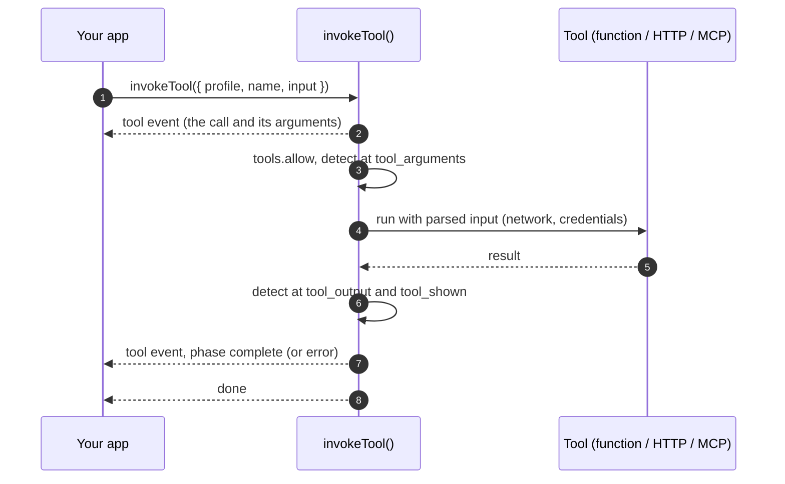

In a host profile (`type: 'host'`), your code is the orchestrator. No model picks the next step: your app names the tool and its input, and Theorem runs it under the same permissions and traces as any agent, guarded by `detect` and `network`. Use it for function, HTTP and MCP tools that your own code calls. Your code can still call a model between tools, for example with `runDecision`, because that call goes to another profile.

## Define a host profile

A host profile has six fields: `type`, `id`, `tools`, and the optional `guardrails`, `observability` and `labels`. It has no `models` and no `identity`, because the profile itself never runs a model.

```ts
import { defineProfile } from '@theoremjs/agents';

export const toolGateway = defineProfile({
	type: 'host',
	id: 'harbor.tool_gateway',

	tools: {
		allow: ['manifest_lookup', 'weather_radar', 'mcp_customs_query'],
		parallel: true, // the calls of one invokeToolStep run side by side
	},
});
```

* **`tools.allow`** is required. Every tool it lists can be invoked, with no visibility tiers, loading tiers or path gating. A provider's own builtin tool cannot go here, because a host profile never runs a model: registering the profile fails.
* **`tools.parallel`** applies to `invokeToolStep`. When `true`, the calls of one step run side by side. When left out or `false`, they run one at a time, in the order given.
* **`guardrails`** takes only `detect` and `network`. These are the guards that fire when a tool is invoked. `defineProfile` refuses the others (quota, canary and egress), because they guard a model turn. `detect` here can name only the tool boundaries.

## What runs when you invoke a tool

`invokeTool()` does not call the tool function directly. It sends the call through the same checks a model's call gets:

* **Allowed.** A tool that `tools.allow` does not list fails with `not_allowed`.
* **Arguments checked.** The `detect` guardrail reads the arguments at the `tool_arguments` boundary for that kind of tool. A block fails the call with `arguments_blocked`.
* **Input parsed.** The input is parsed against the tool's input schema. Input that does not fit fails the call with `invalid_input`.
* **Network checked.** HTTP and MCP calls go through the `network` guardrail. When you pass `resolveHost`, Theorem looks up each host name before it is fetched, and refuses it when any address is private or the name does not resolve. The lookup is skipped for literal addresses and where the network policy already permits private targets.
* **Credentials read when needed.** When you pass `credentials`, Theorem reads a slot from it only when a tool that signs in runs.
* **Output checked.** The `detect` guardrail reads what the tool returns at the `tool_output` boundary, and what the person is shown at `tool_shown`. A blocked output fails the call with `output_blocked`.



## Invoke a tool: `invokeTool()`

`invokeTool()` returns an async generator of turn events. The call starts when you pull the first event.

```ts
import { invokeTool } from '@theoremjs/agents';

const events = invokeTool({
	profile: 'harbor.tool_gateway',
	name: 'manifest_lookup',
	input: {
		trackingNumber: 'TRK-88294100',
	},
});

for await (const event of events) {
	if (event.type === 'tool' && event.tool.phase === 'complete') {
		console.log('Manifest result:', event.tool.output);
	}
}
```

To run several calls as one step, use `invokeToolStep({ profile, calls })`. Each entry of `calls` has a `name` and an `input`. The calls share one tool snapshot, and `tools.parallel` decides whether they run side by side.

`invokeTool()` also runs tools for other profile types, for example to resume a call that a gate held during a turn. A decision or embedding profile cannot invoke tools.

### The events you get

| Event type | Payload | When |
| :--- | :--- | :--- |
| **`tool`** | `event.tool: ToolCallEvent` | First the call and its `arguments`. Then its phases: `running`, `progress` while it runs, then `complete` with the `output`, `gate` when a confirmation, permission or sign-in holds the call, or `error` with the `failure`. |
| **`guardrail`** | `event.guardrail: GuardrailEvent` | A guardrail flagged or blocked something at a tool boundary or on the network. |
| **`done`** | `event.stop: TurnStop` | Always last. `stop.kind` is `completed`, or `gate` when a gate held the call. |
| **`error`** | `event.errorKind: ErrorKind`, `event.error?: string` | The invoke threw outside the call itself. A tool that fails reports it as a `tool` event with phase `error`, not here. |

## Related Guides

* **[Profiles](/docs/profiles)**: Profile identity, inputs and the registry.
* **[Defining Tools](/docs/tools)**: Input schemas, credentials and handlers for tools.
* **[MCP & Remote Tools](/docs/tools/mcp)**: Connecting MCP servers and remote HTTP tools.
