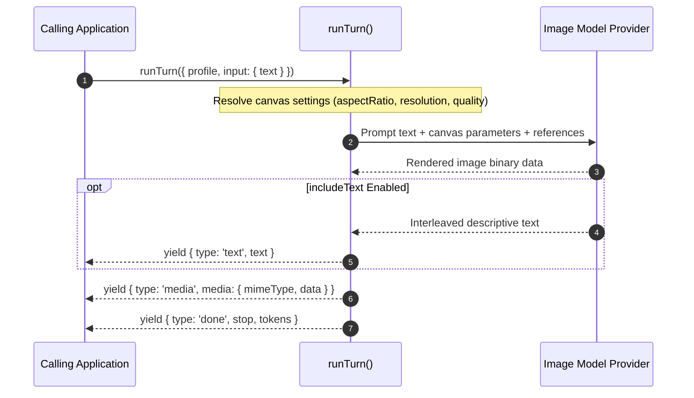

Image profiles (`type: 'image'`) configure agents that generate, edit, or transform visual media assets from text prompts. They execute through `runTurn()`, yielding binary media events alongside optional descriptive text.

## Image Profile Configuration

Base profile fields (`identity`, `models`, `guardrails`, `observability`, `labels`) apply across all modalities as documented in [Profiles](/docs/profiles). Image profiles declare an `image` block for image size, format, quality, and generation controls. This slice shows only that block. It runs on a Gemini image model, which refuses `quality`, `background`, `n` and `outputCompression`, so it sets none of them:

```ts frame=profile:image
image: {
	aspectRatio: '16:9',
	resolution: '2K',
	mimeType: 'image/png',
	seed: 42,
	includeText: true, // Also ask for interleaved text with the images
},
```

## Image Generation Settings

The `image` block configures how downstream providers render generated visual assets:



| Setting | Type | Description |
| :--- | :--- | :--- |
| **`aspectRatio`** | `string` | The shape of generated images, such as `'16:9'`. |
| **`resolution`** | `string` | How detailed generated images are, such as `'1K'`, `'2K'`, or `'4K'`. |
| **`mimeType`** | `string` | The file type of generated images. A provider that takes a fixed set of types may use PNG for any other. |
| **`quality`** | `string` | How much effort the model spends on each image: `'auto'`, `'low'`, `'medium'`, or `'high'`. A provider that has no such setting refuses it. |
| **`background`** | `string` | The background of generated images: `'auto'`, `'transparent'`, or `'opaque'`. A provider that has no such setting refuses it. |
| **`n`** | `number` | How many images one request makes, where the provider takes a count. |
| **`seed`** | `number` | A seed for repeatable images, where the provider and the model honour it. |
| **`outputCompression`** | `number` | Compression from 0 to 100 for JPEG and WebP images, where the provider takes it. |
| **`references`** | `Array<TurnBlob \| TurnMediaRef>` | Images sent with every turn, before the user's. Each is bytes (`data`) or a link (`uri`). Some providers take http(s) links only, and none with `includeText`. |
| **`includeText`** | `boolean` | Whether the model may write text alongside its images. With some providers this also sends the system instruction and history. |

Each setting is sent only where the provider has it. A setting the provider lacks is refused or ignored, as the table says.

## Invoking Image Profiles: `runTurn()`

Image profiles are executed using `runTurn()`, following the request patterns established in [Text Profiles](/docs/profiles/text). Instead of streaming completion text deltas alone, the turn yields `media` events containing base64-encoded image payloads.

### Basic Invocation

```ts
import { runTurn } from '@theoremjs/agents';

const events = runTurn({
	profile: 'harbor.blueprint_illustrator',
	input: {
		text: 'Aerial architectural rendering of a modern deepwater shipping container berth at twilight.',
	},
});

for await (const event of events) {
	if (event.type === 'media') {
		// event.media is { mimeType, data }, with data in base64
		saveImage(event.media.data, 'berth.png'); // The profile asks for image/png
	}
	if (event.type === 'text') {
		// Emitted only when image.includeText is enabled
		process.stdout.write(event.text);
	}
}
```

### Key Image Events

| Event Type | Payload | Description |
| :--- | :--- | :--- |
| **`media`** | `event.media: { mimeType: string, data: string }` | Emitted when image generation finishes, containing the base64-encoded file bytes and MIME type. |
| **`text`** | `event.text: string` | Incremental descriptive text delta, emitted only when `image.includeText: true`. |
| **`done`** | `event.stop: TurnStop`, `event.tokens?: TurnTokens` | Terminal event signaling completion and token consumption. |
| **`error`** | `event.errorKind: ErrorKind`, `event.error?: string` | Emitted if provider generation fails, content safety filters trigger, or network times out. |

## Related Guides

* **[Profiles](/docs/profiles)**: Universal profile identity, model bindings, inputs, and registry lifecycle.
* **[Text Profiles](/docs/profiles/text)**: Multi-step conversational agents and complete `runTurn()` mechanics.
* **[Model Bindings](/docs/profiles/bindings)**: Declaring image generation models, credential slots, and timeouts.
