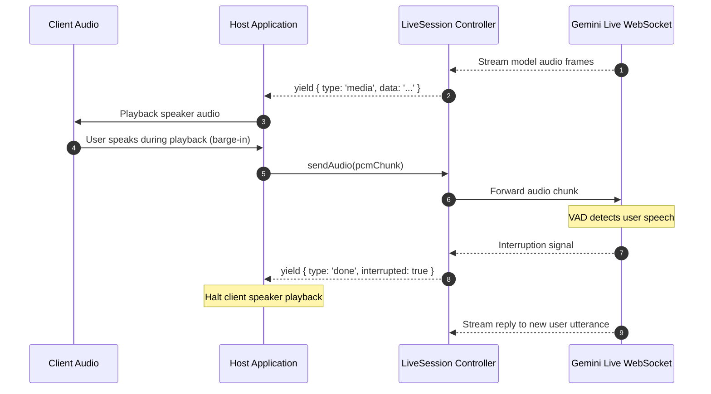
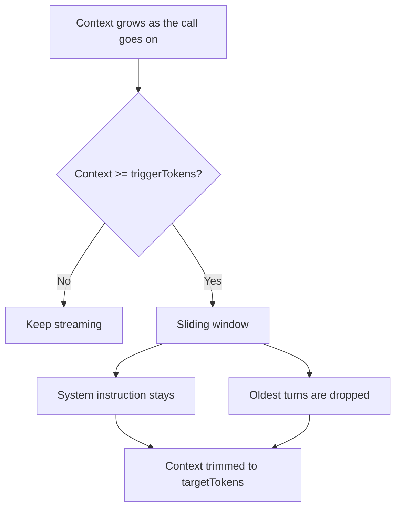

Live profiles (`type: 'live'`) configure realtime agents that communicate over bidirectional WebSockets using audio, camera frames, and typed text. They are opened with `runSession()`, which establishes a persistent provider socket, coordinates voice activity detection and user barge-in, compresses conversation context for long sessions, and executes tools during live conversations.

## Live Profile Configuration

Base profile fields (`identity`, `models`, `tools`, `guardrails`, `observability`) apply across all modalities as documented in [Profiles](/docs/profiles). Live profiles connect over bidirectional WebSockets using Gemini's Multimodal Live API (the currently supported live provider). They declare a dedicated `live` block configuring audio settings, ingress channels, interruption policies, and context window compression. This slice shows only that block:

```ts frame=profile:live
live: {
	voice: 'Aoede',
	ingress: {
		text: true, // Typed text messages (off by default; audio and video are on)
	},
	vad: {
		activityHandling: 'START_OF_ACTIVITY_INTERRUPTS', // The user speaking cuts the reply off
		startSensitivity: 'START_SENSITIVITY_LOW',
		endSensitivity: 'END_SENSITIVITY_LOW',
		silenceDurationMs: 500,
	},
	contextCompression: {
		triggerTokens: 800_000,
		slidingWindow: { targetTokens: 400_000 },
	},
	sessionResumption: true,
	greeting: 'Harbor dispatch online. State your vessel identifier.',
	resumed: {
		prompt: 'Vessel connection restored. Confirm current vessel status.',
		afterMs: 15_000,
	},
},
```

## Ingress Channels & Voice Activity Detection

Live sessions process streaming input in real time. The `live.ingress` and `live.vad` blocks govern what inputs the session accepts and how user speech interrupts model output.

### Ingress Modalities

The `ingress` block defines which media channels the host application can push to the active session:

* **`audio`** *(default: `true`)*: Enables raw PCM audio input via `session.sendAudio()`.
* **`video`** *(default: `true`)*: Enables JPEG camera frame streaming via `session.sendVideo()`.
* **`text`** *(default: `false`)*: Enables typed text injections via `session.sendText()`.

### Interruption Handling (Barge-in)

Realtime voice conversations require natural turn-taking. The `live.vad` block configures Voice Activity Detection:



| Property | Values | Description |
| :--- | :--- | :--- |
| **`activityHandling`** | `'START_OF_ACTIVITY_INTERRUPTS'` \| `'NO_INTERRUPTION'` | Whether the user speaking interrupts the model's reply. `'START_OF_ACTIVITY_INTERRUPTS'` cuts the reply off. `'NO_INTERRUPTION'` lets the model finish its reply. |
| **`startSensitivity`** | `'START_SENSITIVITY_LOW'` \| `'START_SENSITIVITY_HIGH'` | How readily the session decides the user has started speaking. `LOW` detects the start of speech less often. |
| **`endSensitivity`** | `'END_SENSITIVITY_LOW'` \| `'END_SENSITIVITY_HIGH'` | How readily the session decides the user has stopped speaking. `LOW` waits through pauses. `HIGH` ends speech at shorter pauses. |
| **`prefixPaddingMs`** | `number` | How long speech must last, in milliseconds, before it counts as the user starting to speak. |
| **`silenceDurationMs`** | `number` | How long a silence, in milliseconds, ends the user's speech. |

Each property you leave out takes the provider default.

When a user interrupts model speech, Theorem emits an event with `interrupted: true`, allowing the host application to cancel client-side audio playback immediately.

## Context Compression for Long Sessions

Live sessions fill their context quickly. Without compression, Gemini ends audio sessions at 15 minutes and audio-video sessions at 2.



The `live.contextCompression` block trims the session's context once it grows past the trigger:

```ts frame=profile:live
live: {
	contextCompression: {
		triggerTokens: 800_000, // Token count that triggers compression
		slidingWindow: {
			targetTokens: 400_000, // Target token count after compression
		},
	},
}
```

When the context, counted before a turn, reaches `triggerTokens`, the provider applies a sliding window. It drops the oldest turns and keeps `targetTokens` tokens. The system instruction stays.

* **`triggerTokens`**: A whole number above 0. Omit it for the provider default (Gemini: 80% of the model's context window).
* **`slidingWindow.targetTokens`**: A whole number above 0, below `triggerTokens`. Omit it for the provider default (Gemini: half of `triggerTokens`).

If `contextCompression` is omitted, the provider terminates the session when its hard context limit is reached.

## Session Resumption & Greetings

Mobile connections drop frequently. The `sessionResumption` and `resumed` blocks manage reconnections and conversation continuity:

```ts frame=profile:live
live: {
	sessionResumption: true,
	greeting: 'Harbor dispatch online. State your vessel identifier.',
	resumed: {
		prompt: 'Vessel connection restored. Confirm current vessel status.',
		afterMs: 15_000,
	},
}
```

* **`greeting`**: A prompt the call sends itself when it opens new, so the agent speaks first. The visitor does not see it. Without it, the agent waits. A call that sends its own `input` at setup gets no greeting.
* **`sessionResumption`**: Asks the provider for resume handles. The host can pass a handle to a new session to carry this one on.
* **`resumed`**: What happens when a call comes back after a drop. It needs `sessionResumption`. The session keeps no clock across calls, so the host passes `awayMs` when it opens the resumed session. If the caller was away for at least `afterMs` (default: 3 seconds), the call sends itself `prompt`, so the agent says it is back. A shorter drop resumes silently.

## Invoking Live Sessions: `runSession()`

Live sessions are opened using `runSession(request, options)`. The options carry the key vault and transport settings. Unlike `runTurn()`, which runs a discrete exchange and closes, `runSession()` resolves a persistent `LiveSession` controller.

### Basic Invocation

```ts
import { runSession } from '@theoremjs/agents';

// 1. Open the persistent session
const session = await runSession(
	{
		profile: 'harbor.live_dispatch',
	},
	hostOptions,
);

// 2. Stream audio chunks from microphone
await session.sendAudio({
	data: base64PcmChunk,
	mimeType: 'audio/pcm;rate=16000',
});

// 3. Consume realtime events from the provider
for await (const event of session.events()) {
	if (event.type === 'text') {
		process.stdout.write(event.text);
	}
	if (event.type === 'media') {
		playSpeakerAudio(event.media.data); // Base64 PCM audio chunk
	}
}
```

### `LiveSession` Controller Methods

The `LiveSession` object provides methods to push media, inject context, and close the connection:

| Method | Signature | Description |
| :--- | :--- | :--- |
| **`sendAudio`** | `({ data, mimeType }) => Promise<void>` | Sends a PCM audio chunk to the model (`audio/pcm;rate=16000`). |
| **`sendVideo`** | `({ data, mimeType }) => Promise<void>` | Sends a single camera frame (`image/jpeg`). |
| **`sendText`** | `(text) => Promise<void>` | Sends typed text. The profile must set `live.ingress.text: true`. |
| **`sendContext`** | `(context) => Promise<void>` | Tells the model what the page or host knows. It opens no turn and draws no reply. The model sees it from its next turn on. |
| **`events`** | `() => AsyncGenerator<TurnEvent>` | Returns the stream of incoming text, media, tool calls, and lifecycle events. |
| **`close`** | `(reason?) => Promise<void>` | Ends the session. `events()` stops. |

### Key Live Events

As the model streams back responses, `session.events()` yields events:

| Event Type | Payload | Description |
| :--- | :--- | :--- |
| **`text`** | `event.text: string` | A text part of the model's reply. |
| **`evidence`** | `event.text`, `event.evidence.kind` | A transcript of speech: `output_transcription` for the model, `input_transcription` for the user. `evidence.interim: true` marks a draft transcript of the user. |
| **`media`** | `event.media: { mimeType, data }` | A base64 chunk of the model's voice. Gemini PCM arrives wrapped as `audio/wav`. |
| **`done`** | `event.stop`, `event.interrupted?: boolean` | `stop.kind` is `generation_complete` when the model finishes an utterance. It is `interrupted`, with `interrupted: true`, when the provider reports that the user spoke over the model. |
| **`tool`** | `event.tool: ToolCallEvent` | Emitted when the model calls a tool during the conversation. |

## Browser Client & WebSocket Relay

In production web applications, browsers cannot connect directly to Gemini Live without exposing backend API credentials.

Theorem resolves this using a relay architecture:
* **Backend Relay**: Your application server hosts a WebSocket relay endpoint (e.g. `/api/live/relay`) powered by `runSession()`.
* **Browser Client (`@theoremjs/web/client`)**: `LiveSessionClient` connects to your relay. It sends the microphone as 16-bit 16 kHz PCM and plays the model's voice without gaps (raw PCM is read as 24 kHz). On barge-in it clears the queued audio at once. It asks the browser for echo cancellation, and it holds back quiet mic audio while the model speaks.
* **React (`@theoremjs/react/live`)**: The `LiveRunner` component runs a live session on the Astryx UI.

For browser setup and relay handlers, see [Headless Web & Transport](/docs/web) and [React Live Components](/docs/web/react-hooks).

## Related Guides

* **[Profiles](/docs/profiles)**: Base identity, model bindings, and registry lifecycle.
* **[Defining Tools](/docs/tools)**: Configuring tools that live agents can invoke mid-conversation.
* **[Turn Resumption & Steering](/docs/profiles/resumption)**: Tool gates and human-in-the-loop approvals during live sessions.
* **[Headless Web & Transport](/docs/web)**: Building browser-to-server WebSocket relays for realtime audio.
