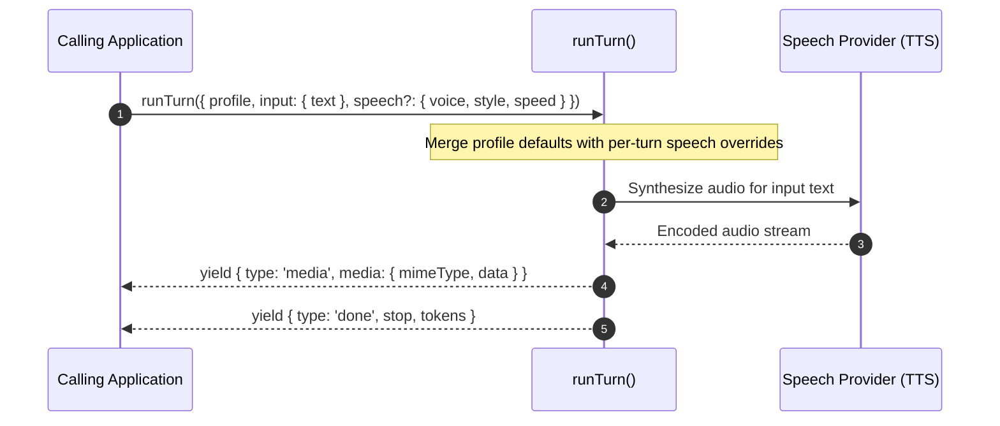

Speech profiles (`type: 'speech'`) configure text-to-speech (TTS) agents that synthesize spoken audio files from written transcripts. They execute through `runTurn()`, transforming input text into binary audio streams.

## Speech Profile Configuration

Base profile fields (`identity`, `models`, `guardrails`, `observability`, `labels`) apply across all modalities as documented in [Profiles](/docs/profiles). Speech profiles declare a `speech` block for the voice, delivery style, speaking rate, and audio format. This slice shows only that block. It runs on a Gemini speech model, which needs a `voice` and has no `speed` field, so the pace goes in `style`:

```ts frame=profile:speech
speech: {
	voice: 'Kore', // Gemini speech has no default voice
	style: 'authoritative maritime dispatch; clear enunciation and measured pacing',
	format: 'mp3', // 'pcm' | 'mp3'
},
```

## Audio Synthesis Settings & Overrides

The `speech` block specifies default audio synthesis properties:



| Property | Type | Description |
| :--- | :--- | :--- |
| **`voice`** | `string` | The upstream TTS voice ID or voice alias recognized by the bound provider. |
| **`style`** | `string` | Plain-text guidance describing pace, accent, or delivery emotion (e.g. `'calm emergency broadcast'`). This instruction is interpreted by the provider and never spoken aloud. |
| **`speed`** | `number` | The speaking rate. `1` is the voice's own pace. |
| **`format`** | `'pcm' \| 'mp3'` | The audio encoding. A provider that cannot make the format refuses the turn. |

### Per-Turn Overrides

Callers can override `voice`, `style`, and `speed` dynamically for an individual turn without changing the profile definition:

```ts frame=statements
const events = runTurn({
	profile: 'harbor.radio_announcer',
	input: {
		text: 'Gale warning in effect for harbor approaches until 0400 hours.',
	},
	speech: {
		speed: 1.15,
		style: 'urgent dispatch',
	},
});
```

Any field declared in `TurnRequest.speech` supersedes the corresponding profile default for that turn alone.

## Invoking Speech Profiles: `runTurn()`

Speech profiles are invoked through `runTurn()`, following the request dispatch flow documented in [Text Profiles](/docs/profiles/text). Instead of streaming text tokens, speech turns yield binary audio payloads.

### Basic Invocation

```ts
import { runTurn } from '@theoremjs/agents';

const events = runTurn({
	profile: 'harbor.radio_announcer',
	input: {
		text: 'Vessel Northern Star, proceed to anchorage bravo.',
	},
});

for await (const event of events) {
	if (event.type === 'media') {
		// event.media contains { mimeType: 'audio/mp3', data: string } (base64-encoded)
		playAudio(event.media.mimeType, event.media.data);
	}
}
```

### Key Speech Events

| Event Type | Payload | Description |
| :--- | :--- | :--- |
| **`media`** | `event.media: { mimeType: string, data: string }` | Emitted when audio synthesis completes, containing the base64-encoded audio bytes and MIME type. |
| **`done`** | `event.stop: TurnStop`, `event.tokens?: TurnTokens` | Terminal event reporting completion status and character or token usage. |
| **`error`** | `event.errorKind: ErrorKind`, `event.error?: string` | Emitted if synthesis fails, the voice is unavailable, or the audio format is unsupported. |

## Related Guides

* **[Profiles](/docs/profiles)**: Universal profile identity, model bindings, inputs, and registry lifecycle.
* **[Text Profiles](/docs/profiles/text)**: Conversational agents and complete `runTurn()` mechanics.
* **[Live Profiles](/docs/profiles/live)**: Realtime bidirectional audio and voice activity detection over WebSockets.
