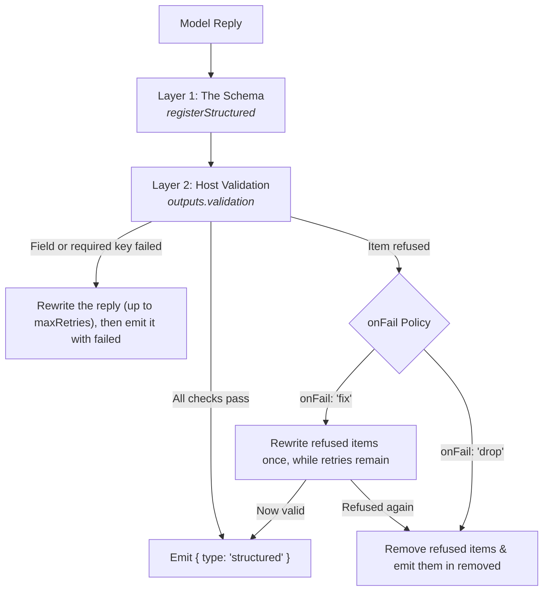

Text profiles (`type: 'text'`) configure conversational agents that reason across multi-step tool loops, stream incremental text, and optionally enforce structured JSON schemas. They are invoked through `runTurn()`, which dispatches the request to the bound model, executes permitted tools, validates output contracts, and yields real-time execution events.

## Text Profile Configuration

Base profile fields (`identity`, `models`, `tools`, `guardrails`, `observability`) apply across all modalities as documented in [Profiles](/docs/profiles). By default, text profiles generate conversational markdown and text streams. Text profiles can optionally configure structured output contracts (`outputs.structured`) and what the last step may do (`turnBehaviour.atStepLimit`). This slice shows only those two blocks. The research scout sets `atStepLimit: 'answer'` and answers in the `research.reply` shape, or in `research.models` when its `focus` picks that, as a later section shows:

```ts frame=profile:text
// Answer in a validated JSON shape instead of freeform text
outputs: {
	structured: 'research.reply',
	// ...
},
turnBehaviour: {
	// What the last model call under maxSteps may do
	atStepLimit: 'answer', // 'answer' sends it without tools; 'stop' (default) lets it call tools and stops the turn
},
```

## Structured Output Contracts

By default, text agents return conversational prose. When an application requires guaranteed data shapes, declare `outputs.structured`.

Theorem enforces structured outputs across two distinct boundaries: the schema the model answers to, and host-side validation of what it wrote.



### Schema Registration

Structured outputs reference registered JSON schemas. Define and register the schema in the kernel registry before binding it to a profile:

```ts frame=statements
registerStructured('research.reply', {
	jsonSchema: {
		type: 'object',
		properties: {
			summary: { type: 'string' },
			candidates: {
				type: 'array',
				items: {
					type: 'object',
					properties: {
						kind: { type: 'string', enum: ['model', 'dataset', 'paper', 'repo', 'method'] },
						basis: { type: 'string', enum: ['page', 'lead', 'memory'] },
						evidence: {
							type: 'array',
							items: {
								type: 'object',
								properties: {
									uri: { type: 'string' },
									quote: { type: 'string' },
								},
								required: ['uri', 'quote'],
							},
						},
						// ...
					},
					// ...
				},
			},
			// ...
		},
		// ...
	},
});
```

### Upstream Schema Enforcement

When `outputs.structured` names a registered schema, Theorem gives the model that JSON Schema with the call. How it does that depends on whether the turn has tools:

* **With tools**, as the scout has: the model answers by calling a tool named `final_answer`, whose parameters are the schema, and the reply is the arguments of that call. Many endpoints refuse a response format beside tools, so this tool takes its place. It stays on the last step under `atStepLimit: 'answer'`, when your tools are gone. If the model ends without calling it, the turn asks again while `validation` has a retry left, and otherwise fails with a `bad_response` error. No tool of your own may use the name `final_answer`.
* **Without tools**: OpenAI-compatible chat gets `response_format` with `type: 'json_schema'` and `strict: true`. Gemini Interactions gets `responseFormat` as JSON text with that schema.

The schema sets the **shape**: `summary` is a string and `candidates` is a list. It cannot check the facts. The model provider cannot execute application code, inspect external databases, or cross-reference facts against tool responses. A model can return well-formed JSON with a quote no source ever said.

### Host Validation & Targeted Repair

The `validation` block provides deterministic enforcement in your application process after the JSON is produced. The cite-or-fail rule is the `candidates` entry, and you write its `check`. The `summary` check is an extra, there to show `fields`:

```ts frame=profile:text
outputs: {
	// ...
	validation: {
		maxRetries: 2,
		fields: {
			// You write this check too: the reply must say what the search found
			summary: (candidate) =>
				String(candidate).trim()
					? { isValid: true }
					: { isValid: false, error: 'Say what the search found.' },
		},
		items: {
			candidates: {
				// You write this check: each quote must be in what the tools returned this turn
				check: (item, turn) => {
					const { evidence = [] } = item as { evidence?: { uri: string; quote: string }[] };
					const read = turn.toolResults.map(({ output }) =>
						typeof output === 'string' ? output : JSON.stringify(output),
					);
					const invented = evidence.find(({ quote }) => !read.some((text) => text.includes(quote)));
					return invented
						? {
								isValid: false,
								error: `These words are not in what the tools returned for ${invented.uri}. Quote them exactly.`,
							}
						: { isValid: true };
				},
				onFail: 'fix', // 'fix' asks the model to rewrite refused items; 'drop' removes them
			},
		},
	},
},
```

* **`fields` (Format & Domain Constraints)**: Dotted paths to specific properties, each with your check on that value. Use this to verify checksums, test regex formats, or query databases. A failure sends its error back to the model, which rewrites the reply while retries remain.
* **`items` (Tool Corroboration)**: Dotted paths to array properties. The check receives one array item and the `turn` context, including `turn.toolResults`: every tool call the turn completed, each with its `tool` and `output`. Use this to verify that items in the model's structured answer match the data returned by tools earlier in the turn. A refused item never fails the reply, and the rest of the reply is kept.
* **`onFail` (Surgical Remediation)**: When a list item fails its check:
  * `'fix'`: Theorem asks the model to rewrite *only the refused items*, keeping the valid ones and avoiding a full regeneration. It does this once, while retries remain. Any item refused again is removed.
  * `'drop'`: Theorem removes refused items from the array and continues.
* **`maxRetries`**: How many times the model may rewrite a reply that fails your checks or the schema's required keys. Left out, there are no rewrites, so `'fix'` removes refused items at once. Once retries run out, the reply goes out as it is. Under `streaming.mode: 'sse'`, an attempt that gets rewritten has already streamed.

The `structured` event says what happened. `removed` lists each item taken out, with its list's path and the reason. `failed` lists the fields still invalid when retries ran out.

The scout's check above is the plain idea, and it is yours to write. It compares exact text, and a candidate with empty `evidence` passes. Yours can be stricter: compare text with case and spacing evened out, refuse a candidate whose `basis` is `page` when it has no evidence, or match each quote to the tool result for its `uri`.

### Dynamic Schema Selection by Turn Slot

A slot can pick the reply's shape, so what the turn chose decides what comes back. The scout uses its `focus` slot. A turn that looks on Hugging Face gets `research.models`, and any other turn gets `research.reply`:

```ts frame=profile:text
outputs: {
	structured: {
		by: 'focus',
		map: {
			'Hugging Face Open Research': 'research.models',
		},
		fallback: 'research.reply',
	},
}
```

`research.models` is `research.reply` with more on each candidate: `kind` can only be `model`, and `task` and `license` are required.

When slot mapping is declared, Theorem reads `TurnRequest.input.slots[by]` to select the schema. If the slot matches a key in `map`, that schema is applied; otherwise, it defaults to `fallback`. Registering the profile fails if `by` is not a slot in `inputs.slots`, if a key in `map` is not one of its choices, or if a schema it names is not registered.

## Step Limit Handling

When an agent calls tools, each round of model generation and tool execution consumes one step against `profile.maxSteps`. The `turnBehaviour.atStepLimit` setting determines the terminal policy when `maxSteps` is reached:

| Mode | Behavior | Use Case |
| :--- | :--- | :--- |
| **`'stop'`** *(default)* | The last model call may still call tools. If it does, the turn ends with stop kind `'step_limit'` and has no answer. | Strict execution budgets or automated pipelines requiring deterministic step ceilings. |
| **`'answer'`** | On the final permitted step, Theorem suppresses your tool definitions from the model prompt. The model cannot call additional tools and must write a textual response synthesizing accumulated evidence. | User-facing assistants that must deliver a partial answer rather than a blank halt when research takes too many steps. |

When using `atStepLimit: 'answer'`, `profile.maxSteps` must be set to `2` or higher during registration to allow at least one step for tool calling before the answer step. The scout sets `maxSteps: 32` and `atStepLimit: 'answer'`, so a long search still ends in an answer.

## Invoking Text Profiles: `runTurn()`

Text profiles are executed using `runTurn()`. The runner returns an async generator yielding incremental `TurnEvent` objects as execution progresses.

### Basic Invocation

You only need to handle the events your application requires. For example, streaming text to the terminal and reading the final structured output:

```ts frame=statements
const events = runTurn({
	profile: 'research.scout',
	input: {
		text: 'Find primary sources on episodic memory for language models and return findings with a verbatim quote for each candidate.',
	},
	system: 'Treat a blog or a list as a lead to its primary source.', // One-off instruction for this turn
});

for await (const event of events) {
	if (event.type === 'text') {
		process.stdout.write(event.text);
	}
	if (event.type === 'structured') {
		console.log('\nResearch reply:', event.structured);
	}
}
```

* **`system`**: Appends dynamic, one-off instructions to this turn alone without mutating the profile's permanent `identity.system`.
* **`path`**: Selects the execution channel, exposing only registered tools declaring this path or wildcard (`paths: ['*']`). Every scout tool declares the wildcard, so a `path` changes nothing for it.

Because `runTurn()` returns an async generator, execution begins when the caller pulls the first event.

### Turn Event Catalog

For full-featured conversational interfaces, `runTurn()` emits granular lifecycle events throughout the turn:

| Event Type | Key Payload | Description |
| :--- | :--- | :--- |
| **`text`** | `text: string` | Incremental completion text token delta. |
| **`thought`** | `text: string` | Incremental internal reasoning token delta (when `streaming.streamThoughts` is enabled). |
| **`tool`** | `tool: ToolCallEvent` | Tool execution updates: emitted when a tool call starts (`input`) and when it finishes (`output`). |
| **`structured`** | `structured: unknown`, `removed?: RemovedItem[]`, `failed?: InvalidField[]` | The reply as JSON. `removed` lists items your item rules took out. `failed` lists fields still invalid when retries ran out. |
| **`stage`** | `stage: TurnStage` | Lifecycle transitions: `'pre_turn'`, `'pre_tool'`, `'post_tool'`, `'before_end'`, `'post_turn'`. |
| **`done`** | `stop: TurnStop`, `tokens?: TurnTokens` | Terminal event emitted when the turn concludes, reporting stop reasons and token counts. |
| **`error`** | `errorKind: ErrorKind`, `error?: string`, `errorCopy?`, `errorInternal?` | The turn failed. `error` is the safe wording for users. `errorCopy` is the label key behind it. `errorInternal` is detail for traces and logs: never show it to users. |

## Related Guides

* **[Profiles](/docs/profiles)**: Universal profile identity, model bindings, inputs, and registry lifecycle.
* **[Defining Tools](/docs/tools)**: Declaring parameter schemas, credentials, and execution handlers for tools.
* **[Turn Resumption & Steering](/docs/profiles/resumption)**: Resuming turns from tool gates, continue tokens, and mid-turn user steering.
