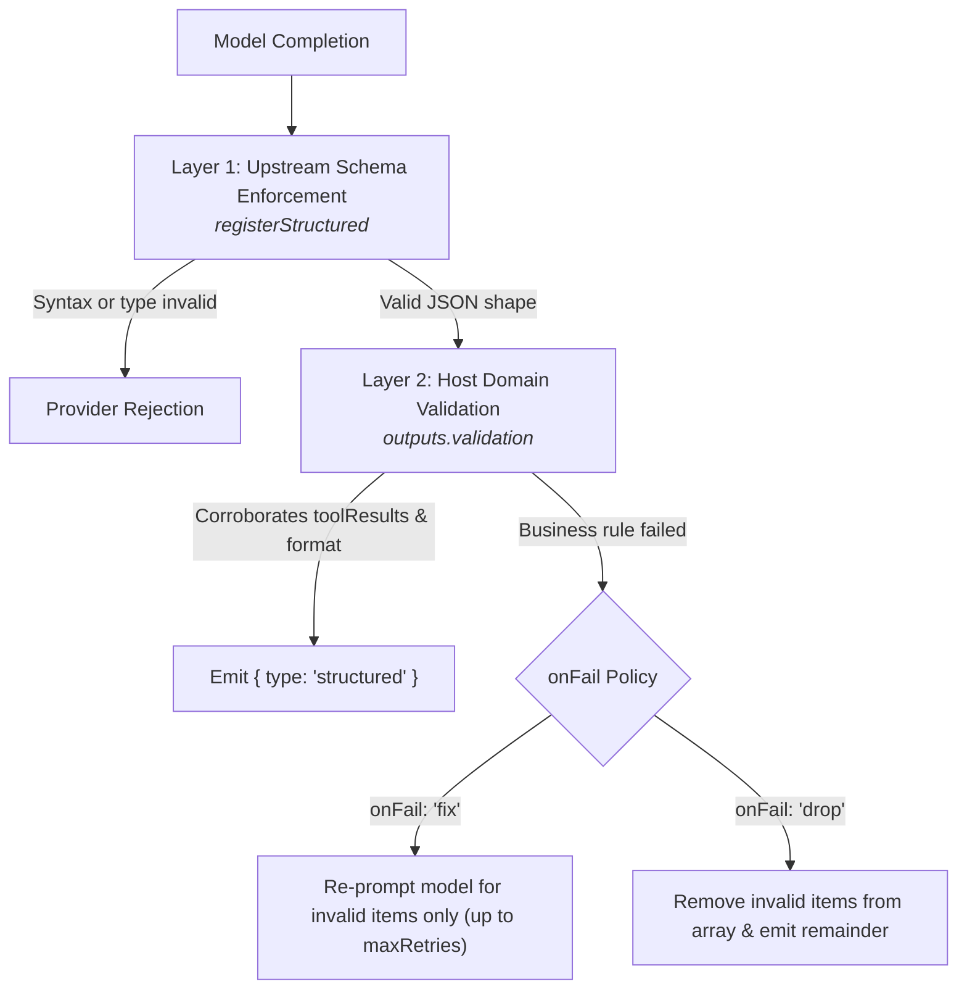

Text profiles (`type: 'text'`) configure conversational agents that reason across multi-step tool loops, stream incremental text, and optionally enforce structured JSON schemas. They are invoked through `runTurn()`, which dispatches the request to the bound model, executes permitted tools, validates output contracts, and yields real-time execution events.

## Text Profile Configuration

Base profile fields (`identity`, `models`, `tools`, `guardrails`, `observability`) apply across all modalities as documented in [Profiles](/docs/profiles). By default, text profiles generate conversational markdown and text streams. Text profiles can optionally configure structured output contracts (`outputs.structured`) and what the last step may do (`turnBehaviour.atStepLimit`). This slice shows only those two blocks:

```ts frame=profile:text
// Optional: enforce a validated JSON shape instead of freeform text
outputs: {
	structured: 'customs_declaration_v1',
	validation: {
		fields: {
			'declaration.trackingNumber': async (candidate) => {
				const isValid = /^TRK-[A-Z0-9]{8}$/.test(String(candidate));
				return isValid
					? { isValid: true }
					: { isValid: false, error: 'Tracking number must match TRK-XXXXXXXX' };
			},
		},
		items: {
			'declaration.manifestItems': {
				check: async (item, turn) => {
					// Corroborate item against data returned by tools earlier in this turn
					const code = (item as { hsCode?: string }).hsCode;
					const knownCodes = turn.toolResults.flatMap((r) =>
						Array.isArray((r.output as { validCodes?: string[] })?.validCodes)
							? (r.output as { validCodes: string[] }).validCodes
							: [],
					);
					return knownCodes.includes(code ?? '')
						? { isValid: true }
						: { isValid: false, error: `Unverified HS code: ${code}` };
				},
				onFail: 'fix', // 'fix' asks the model to rewrite refused items; 'drop' removes them
			},
		},
		maxRetries: 2,
	},
},
turnBehaviour: {
	// What the last model call under maxSteps may do
	atStepLimit: 'answer', // 'answer' sends it without tools; 'stop' (default) lets it call tools and stops the turn
},
```

## Structured Output Contracts

By default, text agents return conversational prose. When an application requires guaranteed data shapes, declare `outputs.structured`.

Theorem enforces structured outputs across two distinct boundaries: upstream model decoding and host-side business validation.



### Schema Registration

Structured outputs reference registered JSON schemas. Define and register the schema in the kernel registry before binding it to a profile:

```ts
import { registerStructured } from '@theoremjs/agents';

registerStructured('customs_declaration_v1', {
	jsonSchema: {
		type: 'object',
		properties: {
			declaration: {
				type: 'object',
				properties: {
					trackingNumber: { type: 'string' },
					manifestItems: {
						type: 'array',
						items: {
							type: 'object',
							properties: {
								hsCode: { type: 'string' },
								description: { type: 'string' },
							},
							required: ['hsCode', 'description'],
						},
					},
				},
				required: ['trackingNumber', 'manifestItems'],
			},
		},
		required: ['declaration'],
	},
});
```

### Upstream Schema Enforcement

When `outputs.structured` names a registered schema, Theorem sends its JSON Schema to the provider with the call. OpenAI-compatible chat gets `response_format` with `type: 'json_schema'` and `strict: true`. Gemini Interactions gets `responseFormat` as JSON text with that schema. There is no tool-call fallback.

This guarantees **grammar and types**: `trackingNumber` will always be a string, and `manifestItems` will always be an array. However, the model provider cannot execute application code, inspect external databases, or cross-reference facts against tool responses. A model can return syntactically valid JSON containing invented tracking numbers or fictitious manifest items.

### Host Validation & Targeted Repair

The `validation` block provides deterministic enforcement in your application process after the JSON is produced:

* **`fields` (Format & Domain Constraints)**: Dotted paths to specific scalar properties. Use this to verify checksums, test regex formats, or query databases.
* **`items` (Tool Corroboration)**: Dotted paths to array properties. The validator receives the individual array item and the `turn` context, including `turn.toolResults`. Use this to verify that items listed in the model's structured answer match the data returned by tools executed earlier in the turn.
* **`onFail` (Surgical Remediation)**: When a list item fails its check:
  * `'fix'`: Theorem asks the model to rewrite *only the defective items*, preserving all valid items and avoiding full completion regenerations.
  * `'drop'`: Theorem strips invalid items from the array and continues.
* **`maxRetries`**: Limits the number of repair round-trips before the turn emits whatever valid elements settled.

### Dynamic Schema Selection by Turn Slot

For profiles handling multiple document types, `structured` accepts a slot-mapped dictionary:

```ts frame=profile:text
outputs: {
	structured: {
		by: 'declarationType',
		map: {
			freight: 'freight_declaration_v1',
			passenger: 'passenger_declaration_v1',
		},
		fallback: 'general_declaration_v1',
	},
}
```

When slot mapping is declared, Theorem reads `TurnRequest.input.slots[by]` to select the schema. If the slot matches a key in `map`, that schema is applied; otherwise, it defaults to `fallback`.

## Step Limit Handling

When an agent calls tools, each round of model generation and tool execution consumes one step against `profile.maxSteps`. The `turnBehaviour.atStepLimit` setting determines the terminal policy when `maxSteps` is reached:

| Mode | Behavior | Use Case |
| :--- | :--- | :--- |
| **`'stop'`** *(default)* | The last model call may still call tools. If it does, the turn ends with stop kind `'step_limit'` and has no answer. | Strict execution budgets or automated pipelines requiring deterministic step ceilings. |
| **`'answer'`** | On the final permitted step, Theorem suppresses all tool definitions from the model prompt. The model cannot call additional tools and must write a textual response synthesizing accumulated evidence. | User-facing assistants that must deliver a partial answer rather than a blank halt when research takes too many steps. |

When using `atStepLimit: 'answer'`, `profile.maxSteps` must be set to `2` or higher during registration to allow at least one step for tool calling before the answer step.

## Invoking Text Profiles: `runTurn()`

Text profiles are executed using `runTurn()`. The runner returns an async generator yielding incremental `TurnEvent` objects as execution progresses.

### Basic Invocation

You only need to handle the events your application requires. For example, streaming text to the terminal and reading the final structured output:

```ts
import { runTurn } from '@theoremjs/agents';

const events = runTurn({
	profile: 'harbor.customs_auditor',
	input: {
		text: 'Audit declaration #TRK-88294100 against manifest rules.',
		slots: { declarationType: 'freight' },
	},
	system: 'Treat declaration flags with high scrutiny for port authority compliance.', // One-off instruction for this turn
	path: 'customs', // Offer only tools whose paths include 'customs' or '*'
});

for await (const event of events) {
	if (event.type === 'text') {
		process.stdout.write(event.text);
	}
	if (event.type === 'structured') {
		console.log('\nValidated Declaration:', event.structured);
	}
}
```

* **`system`**: Appends dynamic, one-off instructions to this turn alone without mutating the profile's permanent `identity.system`.
* **`path`**: Selects the execution channel, exposing only registered tools declaring this path or wildcard (`paths: ['*']`).

Because `runTurn()` returns an async generator, execution begins when the caller pulls the first event.

### Turn Event Catalog

For full-featured conversational interfaces, `runTurn()` emits granular lifecycle events throughout the turn:

| Event Type | Key Payload | Description |
| :--- | :--- | :--- |
| **`text`** | `text: string` | Incremental completion text token delta. |
| **`thought`** | `text: string` | Incremental internal reasoning token delta (when `streaming.streamThoughts` is enabled). |
| **`tool`** | `tool: ToolCallEvent` | Tool execution updates: emitted when a tool call starts (`input`) and when it finishes (`output`). |
| **`structured`** | `structured: unknown` | Verified JSON object matching the registered schema and passing all host checks. |
| **`stage`** | `stage: TurnStage` | Lifecycle transitions: `'pre_turn'`, `'pre_tool'`, `'post_tool'`, `'before_end'`, `'post_turn'`. |
| **`done`** | `stop: TurnStop`, `tokens?: TurnTokens` | Terminal event emitted when the turn concludes, reporting stop reasons and token counts. |
| **`error`** | `errorKind: ErrorKind`, `error?: string`, `errorCopy?`, `errorInternal?` | The turn failed. `error` is the safe wording for users. `errorCopy` is the label key behind it. `errorInternal` is detail for traces and logs: never show it to users. |

## Related Guides

* **[Profiles](/docs/profiles)**: Universal profile identity, model bindings, inputs, and registry lifecycle.
* **[Defining Tools](/docs/tools)**: Declaring parameter schemas, credentials, and execution handlers for tools.
* **[Turn Resumption & Steering](/docs/profiles/resumption)**: Resuming turns from tool gates, continue tokens, and mid-turn user steering.
