Multi-turn conversations with language models encounter a fundamental architectural tension: upstream providers optimize inference using proprietary server-side caching, assistant threads, or native conversation handles, but distributed host applications require portable, fault-tolerant persistence that can fail over across models and providers without losing context.

Theorem resolves this tension through a **dual-layer state architecture**:
1. **Portable History Layer (`TurnHistoryMessage[]`)**: Universal, provider-agnostic transcripts maintained in open formats (`role`, `content`, `parts`, `reasoning`).
2. **Native Provider Checkpoint Layer (`ProviderCheckpoint`)**: The protocol's saved JSON state, and what it was saved for.

## The Dual-Layer Conversation Model

During multi-turn execution, the host persists both the portable history transcript and the optional native checkpoint:

```mermaid
flowchart TD
		subgraph Host["Host Application"]
				History["Portable History (TurnHistoryMessage[])"]
				Checkpoint["Native Checkpoint (ProviderCheckpoint)"]
		end

		subgraph Kernel["Theorem Engine"]
				Verify["historyHash & compatibilityKey Verification"]
				Fallback{"Drift Detected?"}
				Rebuild["Rebuild from History (provider_state_rebuilt)"]
				ResumeNative["Resume Native Protocol State"]
		end

		subgraph Upstream["Model Provider"]
				NativeSession["Native API Session / Cache"]
		end

		Host -->|runTurn({ history, providerState })| Verify
		Verify --> Fallback
		Fallback -->|Yes (Key, Model, or History Changed)| Rebuild
		Fallback -->|No (State Matches)| ResumeNative
		Rebuild -->|Full Transcript Replay| Upstream
		ResumeNative -->|Incremental Delta| NativeSession
```

If the provider, the model, the connection, the key slot or the covered history changes, Theorem drops the checkpoint and sends the history instead.

## Continuation Policies (`providerContinuation.history`)

The profile's `providerContinuation` block establishes who owns conversation memory:

```ts frame=profile:text
providerContinuation: {
		history: 'host', // 'host' | 'stateless' | 'provider'
	},
```

Continuation policies are scoped strictly to turn types (`text`, `image`, `speech`, and `live`). Profiles targeting `decision`, `embedding`, or `host` do not support continuation and reject this setting during validation.

### Policy Comparison

| Mode | Who holds the conversation | What the host sends | When the turn goes elsewhere |
| :--- | :--- | :--- | :--- |
| **`'host'`** *(Default)* | The host | `input.history` and `providerState` | Theorem drops the checkpoint and sends the history. |
| **`'provider'`** | The provider | `providerState` alone, with no `input.history` | The turn needs the host's history. |
| **`'stateless'`** | Nobody | Neither | Not applicable. A request that carries `input.history` or `providerState` fails with a `request` error, and the `done` event carries no checkpoint. |

## Checkpoint Structure

A `ProviderCheckpoint` holds the upstream state alongside validation digests:

```text
interface ProviderCheckpoint {
	protocol: string;              // The protocol ID, e.g. 'geminiInteractions'
	provider: string;              // The provider ID, e.g. 'gemini'
	version: number;               // The protocol's continuation.version the data was written under
	apiId: string;                 // The upstream model ID
	keySlot?: string;              // The slot whose key the saved state belongs to
	compatibilityKey: string;      // Hash of the provider's connection and the options the protocol keys its state on
	coveredHistoryLength: number;  // How many history messages the state covers
	coveredHistoryHash: string;    // SHA-256 digest of those messages
	data: JsonValue;               // The protocol's own state
	wireCallIds?: Record<string, string>; // The wire's own ID for each Theorem call ID the state holds
}
```

### Transcript Prefix Verification (`historyHash`)

Before it uses a checkpoint, Theorem computes a SHA-256 digest of the first `coveredHistoryLength` history messages (`historyHash`). The digest sorts the keys of each message and removes the `<user_data>` fence around user text, so the same messages give the same digest.

If a host edits, truncates, or prepends messages in earlier parts of the transcript, `coveredHistoryHash` does not match, and Theorem treats the native state as invalidated.

## State Drift & Fallback Warnings

When it restores state, Theorem checks six things, in this order:

```mermaid
flowchart TD
		In[Incoming ProviderCheckpoint] --> C1{Protocol & Provider Match?}
		C1 -->|No| W1["reason: 'provider_changed'"]
		C1 -->|Yes| C2{API ID Matches?}
		C2 -->|No| W2["reason: 'model_changed'"]
		C2 -->|Yes| C3{Contract Version Matches?}
		C3 -->|No| W3["reason: 'version_changed'"]
		C3 -->|Yes| C4{Compatibility Key Matches?}
		C4 -->|No| W4["reason: 'connection_changed'"]
		C4 -->|Yes| C5{Key Slot Matches?}
		C5 -->|No| W5["reason: 'key_changed'"]
		C5 -->|Yes| C6{History Matches?}
		C6 -->|No| W6["reason: 'history_changed'"]
		C6 -->|Yes| Valid[State Restored Incrementally]

		W1 & W2 & W3 & W4 & W5 & W6 --> EmitWarning["Emit provider_state_rebuilt Warning & Replay Transcript"]
```



When drift occurs, execution does not crash. The engine falls back to transcript replay and emits a warning event:

```text
export interface ProviderWarning {
	code: 'provider_state_rebuilt';
	reason:
		| 'provider_changed'    // Checkpoint belonged to another provider
		| 'model_changed'       // Checkpoint belonged to another model
		| 'connection_changed'  // Base URL or transport options changed
		| 'key_changed'         // Key slot changed (e.g., fallback key triggered)
		| 'history_changed'     // History was edited or truncated prior to checkpoint
		| 'version_changed';    // Protocol serialization format version bumped
}
```

## Runner Execution Example

`runTurn` streams events. The `done` event carries `providerState` when the protocol saved one. The host keeps it with the history it stores, and sends both on the next turn:

```ts
import { type ProviderCheckpoint, runTurn, type TurnRequest } from '@theoremjs/agents';

async function ask(request: TurnRequest) {
	let reply = '';
	let providerState: ProviderCheckpoint | undefined;
	for await (const event of runTurn(request)) {
		if (event.type === 'text') reply += event.text;
		if (event.type === 'done') providerState = event.providerState;
	}
	return { reply, providerState };
}

const question = 'Verify cargo container MSKU9012345.';
const first = await ask({ profile: 'harbor.desk', input: { text: question } });

await ask({
	profile: 'harbor.desk',
	providerState: first.providerState,
	input: {
		history: [
			{ role: 'user', content: question },
			{ role: 'assistant', content: first.reply },
		],
		text: 'Inspect customs seal for container MSKU9012345.',
	},
});
```

If the checkpoint does not match the history or the binding, Theorem sends the history instead and emits a `provider_warning` event.

## Stateless Turns

For security-sensitive or high-throughput batch workloads where context retention is unwanted, configure `history: 'stateless'`:

```ts frame=profile:text
providerContinuation: {
		history: 'stateless',
	},
```

When `history: 'stateless'` is set:
1. The `done` event carries no `providerState`.
2. A request that carries `input.history` or `providerState` fails with a `request` error: `A stateless profile takes no conversation history`.

This guarantees that multi-turn history cannot accidentally leak into stateless decision or analysis turns.

## Related Guides

* **[Profiles & Continuation](/docs/profiles)**: Declaring `providerContinuation.history` on agent profiles.
* **[Model Bindings & Key Slots](/docs/providers)**: Multi-model bindings, key slot failover, and fallback routing.
* **[Supported Protocols](/docs/providers/protocols)**: Wire protocols, SSE stream parsers, and modality matrix.
* **[History Compaction](/docs/profiles/compaction)**: Automated token counting, sliding windows, and transcript pruning.
