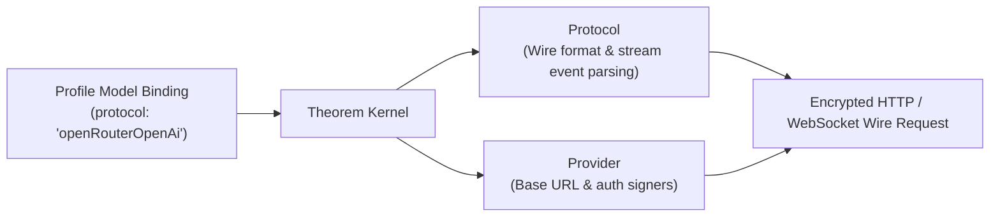

A protocol defines the wire format used to speak to an upstream model provider. It parses streaming events, serializes multimodal inputs, translates tool calls, and extracts citations.

In Theorem, a protocol owns the wire transport and stream parsing, but has no knowledge of endpoints, credentials, or vault slots. Providers declare which protocols their endpoints serve, and profiles bind models to a specific protocol.

## Protocols vs Providers

Wire protocols and network endpoints are strictly separated:



* **Protocols Own the Wire**: They serialize requests into provider JSON bodies, decode SSE stream chunks, re-assemble tool call arguments, parse reasoning tokens, and extract web citations. Protocols never hold URLs, API keys, or key slots.
* **Providers Own the Destination**: They declare the base URL, authentication headers or query parameters, and which protocols their server hosts.

## Choose a protocol for the profile type

Choose a protocol that has an endpoint for your profile type, and a provider that serves it. `registerProfile` rejects a protocol that the provider does not serve, or that has no endpoint for the type.

| Protocol ID | Profile types | Endpoint | Served by |
| :--- | :--- | :--- | :--- |
| **`openRouterOpenAi`** | `text`, `speech` | `/chat/completions`, `/audio/speech` | `openRouterProvider` |
| **`openRouterImages`** | `image` | `/images` | `openRouterProvider` |
| **`openRouterTranscriptions`** | `transcription` | `/audio/transcriptions` | `openRouterProvider` |
| **`openRouterEmbeddings`** | `embedding` | `/embeddings` | `openRouterProvider` |
| **`openRouterDecisions`** | `decision` | `/alpha/decisions` | `openRouterProvider` |
| **`geminiInteractions`** | `text`, `image`, `speech` | `/interactions` | `geminiProvider` |
| **`geminiLive`** | `live` | `/google.ai.generativelanguage.v1beta.GenerativeService.BidiGenerateContent` | `geminiProvider` |
| **`geminiEmbeddings`** | `embedding` | `/models/{apiId}:embedContent` | `geminiProvider` |
| **`openAi`** | `text`, `speech` | `/chat/completions`, `/audio/speech` | `localProvider` |
| **`ollamaEmbeddings`** | `embedding` | `/api/embed` | `localProvider` |
| **`systemOne`** | `decision` | `/systemone` | `typesafeProvider` |

Each first-party provider has a default ID and a connection:

| Provider | ID | Connection | Key |
| :--- | :--- | :--- | :--- |
| `openRouterProvider` | `openrouter` | Optional `baseUrl`, `decisionUrl`, `siteUrl`, `siteName` | Required. Sent as a bearer token |
| `geminiProvider` | `gemini` | Optional `host` | Required. Sent in the `x-goog-api-key` header. Live sends it in the URL query |
| `typesafeProvider` | `typesafe` | Optional `baseUrl` | Required. Sent as a bearer token |
| `localProvider` | `local` | Required `baseUrl` | Optional. Sent as a bearer token |

## Protocol Options (`models.*.options`)

Because profile modality configuration is already defined by the profile type (`inputs`, `outputs`, `tools`, `guardrails`), a builder rarely needs to interact directly with protocols.

The only builder-facing surface on a protocol is its optional `options` schema, configured under `models.<alias>.options` in a profile:

```ts frame=models
models: {
	open: {
		// ...
		options: {
			cache: { mode: 'automatic', ttl: '5m' }, // Protocol-specific setting
		},
	},
}
```

### Supported Protocol Options

| Protocol ID | Option Key | Type | Description |
| :--- | :--- | :--- | :--- |
| **`openRouterOpenAi`** | `cache.mode` | `'automatic'` \| `'system'` | Prompt caching, for models that support it. `'automatic'` caches the whole request. `'system'` caches the system instruction only. |
| | `cache.ttl` | `'5m'` \| `'1h'` | How long the cache is kept. Without it, the upstream default applies. |
| | `provider` | `object` | Which upstreams may answer. See [Choosing Upstreams on OpenRouter](/docs/providers#choosing-upstreams-on-openrouter). |
| **`geminiInteractions`** | `store` | `boolean` | Whether Google keeps the interaction. Off, nothing is stored on the server. |
| | `persistViaInteractionId` | `boolean` | Continues from the stored interaction instead of sending the conversation again. Needs `store`. |
| **`systemOne`** | `images` | `boolean` | Lets a decision hold images and box questions. A request that uses either is refused without it. |
| | `longContext` | `boolean` | Raises the context window from 64k tokens to 262k. |
| **`openRouterTranscriptions`** | `provider` | `object` | `zdr` and `data_collection` only. See [Transcription Profiles](/docs/profiles/transcription#supported-formats-and-routing). |
| **`geminiEmbeddings`** | `taskType` | `string` | The task the vectors are for, such as `RETRIEVAL_QUERY`, `RETRIEVAL_DOCUMENT` or `CLASSIFICATION`. |
| | `outputDimensionality` | `number` | How many numbers each vector holds, for models that can shorten theirs. |
| **`openRouterEmbeddings`** | `encodingFormat` | `'float'` \| `'base64'` | How OpenRouter sends each vector back. Theorem decodes both to the same numbers. |
| **`ollamaEmbeddings`** | `truncate` | `boolean` | On, an input longer than the model reads is cut to fit. Off, the call fails. |
| | `dimensions` | `number` | How many numbers each vector holds, for models that can shorten theirs. |

Protocols without special options (`openAi`, `geminiLive`, `openRouterImages`, `openRouterDecisions`) declare an empty options schema (`z.strictObject({})`).

## Startup Verification

When `registerProfile()` runs, the kernel validates the binding against the protocol:

1. **Provider Check**: Confirms that the registered provider explicitly serves the bound protocol ID (`provider.serves`).
2. **Modality Check**: Confirms that the protocol supports the profile's modality (text, live voice, embeddings, images, speech, transcription, or decisions).
3. **Options Check**: Validates `models.*.options` against the protocol's Zod schema. Unrecognized options or malformed values throw a `TheoremError('config')` before any turns can run.

## Related Guides

* **[Model Bindings & Key Slots](/docs/providers)**: Binding models to key slots, operational limits, and failover keys.
* **[Defining a Provider](/docs/providers/defining)**: Configuring endpoints, base URLs, and authentication signers.
* **[Provider Checkpoints & State](/docs/providers/checkpoints)**: Native checkpoints, continuation policies, and fallback warnings.
* **[Profiles & Modalities](/docs/profiles)**: Modality-specific profile configuration.
