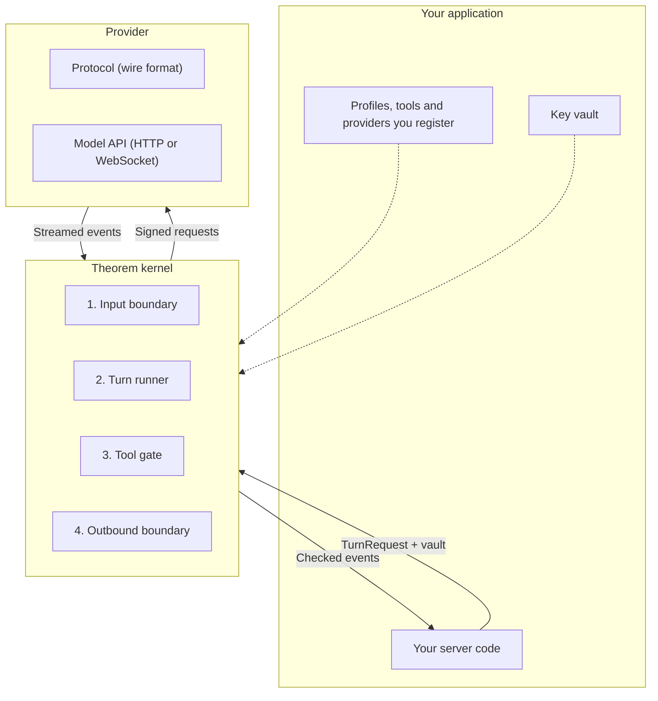
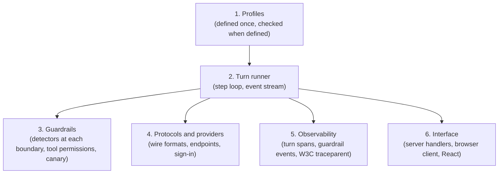
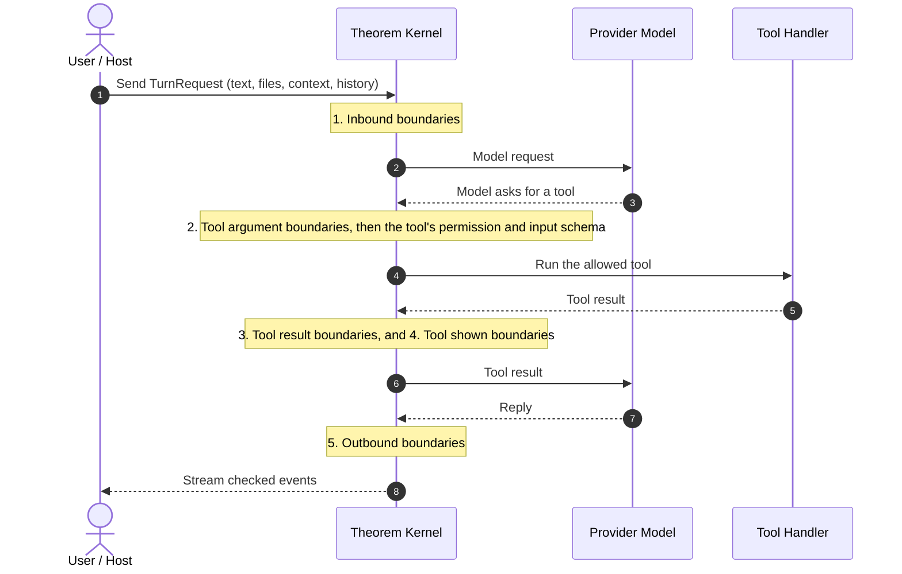

Theorem keeps your application's policy apart from how a turn runs. Your application decides what an agent is and what it may do. Theorem runs each turn inside those limits.

## Host decides, Theorem runs

Your application owns every decision about the agent:

* **Your application owns the policy.** You write the profiles, register the tools and the providers, hold the keys, and choose where traces go.
* **Theorem's own words are defaults that you can replace.** Every string that a person or a model reads comes from your application or from a label default that you can override with `overrideLabels`.
* **Theorem's behaviour is set in the profile.** A default that changes how a turn runs is a profile field, and the field says what leaving it out does.

## No ambient authority

Theorem acts only with what you give it:

* Importing Theorem has no side effects.
* Keys reach Theorem only in the `vault` (`KeyVault`) that you pass with a call. Theorem reads a slot only for the call that names it, and ignores entries that the vault inherits.
* HTTP and MCP tools fetch through a network guard. It checks the URL scheme and refuses loopback, local and private addresses on every redirect hop, unless the profile's `guardrails.network` allows them. When you pass [`resolveHost`](/docs/guardrails/network#host-name-lookups-resolvehost) with the turn, it also refuses a host name that resolves to a private address.

## The three parts of a turn

A turn crosses three parts: your application, the Theorem kernel, and the provider that runs the model.

1. **Your application**: Registers the profiles, tools and providers, holds the keys, and starts each turn with `runTurn`.
2. **Theorem kernel**: Checks the request, runs the steps of the turn, gates each tool call, and reads the text at each boundary before it yields events back.
3. **Provider**: The model's protocol turns the kernel's request into the provider's wire format, and turns the provider's stream back into events. Live sessions run over a WebSocket.

## The parts of the kernel

The kernel's work falls into six parts:

| Part | Scope | Responsibility |
| :--- | :--- | :--- |
| **Profiles** | `defineProfile`, `registerProfile` | `defineProfile` validates a definition and returns the profile, throwing on a malformed one; `registerProfile` defines, validates, and registers a profile in the default scope. |
| **Turn runner** | `runTurn`, `invokeTool`, `invokeToolStep` | `runTurn` runs one turn and streams its events; `invokeTool` runs a held tool call and streams the events of the turn it resumes; `invokeToolStep` runs the host's calls as one step. |
| **Guardrails** | `guardrails` | Detectors read text at five groups of boundaries. Each tool also has a permission (`auto`, `session_consent`, `always_confirm`), and a canary token planted in the instruction shows a leak. |
| **Protocols and providers** | `defineProvider`, `registerProvider` | `defineProvider` defines a provider; nothing in it can change a request or read a reply. `registerProvider` registers it in the default scope, with this project's connection and key slots. |
| **Observability** | `observability` | Writes a trace record (`TraceRecord`) of each turn to the sinks you configure (`TraceSink`), exports spans as OpenTelemetry (`OtlpSpan`), and continues a W3C `traceparent` that you pass. |
| **Interface** | `@theoremjs/web`, `@theoremjs/react` | `@theoremjs/web` serves a profile with `createTheoremHandler`, which streams each turn's events as lines of JSON. `@theoremjs/react` provides the `<TheoremChat />` chat (`@theoremjs/react/ui`), the `<LiveRunner />` voice and video call (`@theoremjs/react/live`), and hooks (`useTheoremChat`, `useTheoremInterface`). |

## The boundaries a turn crosses

Theorem reads text at five groups of boundaries, the same groups that [The Five Boundaries](/docs/guardrails) describes:

1. **Inbound**: The person's message, the text of attachments and voice, slots, context, history, and the host's added text. By default, detectors flag what they find here.
2. **Tool arguments**: What the model sends to a tool. Theorem also checks the arguments against the tool's input schema, and the tool's permission decides whether it runs at once or waits for the person.
3. **Tool results**: What a tool returns, and its error text, before the model reads them. Theorem checks the output against the tool's output schema.
4. **Tool shown**: What a tool call shows the person: its output, error, artifacts and trace.
5. **Outbound**: The model's reply, structured reply, live reply and thoughts. By default, a canary leak or a leak of private instruction text is flagged here.

Each detector's action at each boundary is `ignore`, `flag`, `redact` or `block`. The profile's `guardrails.detect` changes the defaults.

## Why profiles prevent drift

In many applications, an agent's parts live in different files:
* The prompt lives in a template file.
* The model options live in an API client setup.
* The tool list lives in route handlers.
* The input checks live in controller middleware.

Each part changes alone, and after some time the parts do not agree. A route accepts a file type that the model cannot read, or a prompt names a tool that is no longer offered.

In Theorem, **the profile is the single source of truth** for the agent. Its models, the tools it may call (`tools.allow`), the file types it accepts, and its guardrails are all in the profile. You register the tools themselves once, by name. Change the profile, and every turn that runs from it changes.
