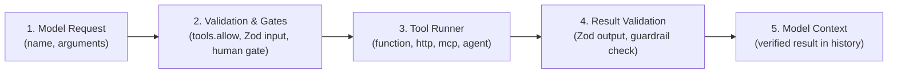
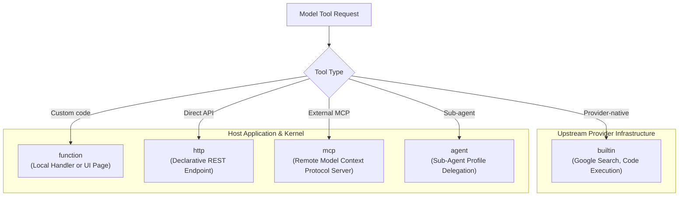

A tool is code or an external capability that a model can request Theorem to execute. You register tools once in your application scope, then name them in each profile that is permitted to invoke them.

Theorem routes all tool calls through a checked execution pipeline that validates inputs, inspects security boundaries, enforces human approval gates, and verifies output shapes before results reach model context.

## Tool Execution Pipeline

When a model requests a tool, Theorem runs the call through five deterministic verification stages:



1. **Step Completion**: The provider stream must conclude without truncation or network drops before pending tool calls are authorized.
2. **Profile Authorization**: The active profile must list the tool in `tools.allow`.
3. **Input Validation**: Arguments are validated against the tool's `input` Zod schema. Malformed arguments reject the call before any handler executes.
4. **Boundary Inspection & Gates**: Egress guardrails inspect arguments for sensitive data. If `permission` requires human approval, execution pauses with `stop: { kind: 'gate' }`.
5. **Output Verification**: The result returned by the runner is validated against the tool's `output` Zod schema and inspected by ingress guardrails before entering model history.

## Tool Types Taxonomy

Theorem categorizes tools into five distinct execution types:



| Type | Execution Host | Typical Use Case | Guide |
| :--- | :--- | :--- | :--- |
| **`builtin`** | Provider | Native capabilities like Google Search or code execution. Declared in model `builtInTools`. | [Model Bindings](/docs/profiles/bindings) |
| **`function`** | Host Process or Browser | Custom TypeScript/JavaScript logic (`handler`) or browser UI DOM tools (`answeredBy: 'page'`). | [Function Tools](/docs/tools/function) |
| **`http`** | Kernel HTTP Client | Direct REST API calls with URL parameter mapping, rate limiting, and size caps. | [HTTP Tools](/docs/tools/http) |
| **`mcp`** | Remote MCP Server | Tools on external servers conforming to the Model Context Protocol, with automatic session pooling. | [MCP Tools](/docs/tools/mcp) |
| **`agent`** | Kernel Runner | Delegating a task to another registered agent profile (`text`, `image`, or `speech`). | [Agent Tools](/docs/tools/agent) |

## Core Tool Attributes

Every custom tool registered with `registerTool` declares metadata that governs how the kernel classifies, routes, and protects the capability:

* **`access`**: `'read-only'`, `'read-write'`, or `'destructive'`:
  * `'read-only'`: Only reads. An `http` tool with this access is sent again when the service is busy or briefly down.
  * `'read-write'`: Changes external state. A write is never sent twice.
  * `'destructive'`: Deletes data, executes financial transactions, or performs irreversible actions. Guardrails can restrict or require confirmation for these calls after reading untrusted data.
* **`permission`**: `'auto'`, `'session_consent'`, or `'always_confirm'`:
  * `'auto'`: Executes without human intervention.
  * `'session_consent'`: Asks once. The approval lasts as long as the host passes the tool name back in `sessionPermissions`.
  * `'always_confirm'`: Demands explicit human approval before every execution (see [Tool Permissions & Gates](/docs/tools/gates)).
* **`loadTier`**: `'T0'` or `'T2'`:
  * `'T0'`: Core tools loaded into model prompt context at the start of every turn.
  * `'T2'`: On-demand tools loaded selectively at turn start via `tools.t1Policy` or mid-turn via a `tools.t2Loader` tool.
* **`paths`**: String array restricting tool availability to specific turn paths (e.g., `['claims']`). Use `['*']` to make the tool available on all paths. When a turn specifies `runTurn({ path: 'claims' })`, only tools whose `paths` include `'claims'` or `'*'` are offered to the model.
* **`category`**: Custom classification label for host-side organization.

## Direct Tool Execution (`runTool` vs `invokeTool`)

Theorem exposes two programmatic entry points for executing registered tools outside an active model turn:

* **`invokeTool(request)`**: Returns an async generator of `TurnEvent`s: the lifecycle events (start, progress, completion, citations) as the tool executes. Ideal for streaming progress to user interfaces or resuming held tool gates.
* **`runTool(request)`**: A Promise-based alternative that resolves to a `ToolCallResult` only when the tool finishes, delivering its final validated output and status directly. Ideal for backend batch operations and headless integrations.

## Dynamic Tool Loading & Profile Binding

A registered tool belongs to no profile until allowed. Profiles declare allowed tools and configure on-demand loading policies in the profile's `tools` block:

```ts frame=profile:text
tools: {
	allow: ['check_hold_status', 'lookup_vessel', 'load_tools', 'issue_refund'],

	// Evaluate at turn start: load claims tools only on claims path
	t1Policy: ({ path }) => (path === 'claims' ? ['issue_refund'] : []),

	// Tool the model can call mid-turn to load additional T2 tools on demand
	t2Loader: 'load_tools',
},
```

* **`allow`**: The complete list of tool IDs permitted for this profile. For zero tools, write `{ allow: [] }`.
* **`t1Policy`**: A host function called at the start of every turn. It receives `ToolLoadContext` (`path`, `input`, `host`) and returns an array of `T2` tool names to load for this turn. Only `text` and `image` profiles run it. You can import your own routing logic here—such as rule-based heuristics, keyword matching, or embedding similarity search.
* **`t2Loader`**: Names a function tool the model can call mid-turn when its current toolset is insufficient. The loader tool executes host search logic and returns `{ loaded: [...] }` with the newly loaded tool names.

Live and host profiles ignore `loadTier` and load all allowed tools at turn start.

## Fix a failed call

A failed call settles with a `code` and a message. Theorem sets these codes for every type of tool.

| Code | Cause | Fix |
| :--- | :--- | :--- |
| `unknown_tool` | No registered tool has this name | Register the tool, or correct the name |
| `not_allowed` | The tool is not in `tools.allow` of the profile | Add the name to `tools.allow` |
| `not_gated` | The `path` of the turn is not in the `paths` of the tool | Add the path, or use `paths: ['*']` |
| `not_loaded` | The tool has `loadTier: 'T2'` and nothing loaded it in this turn, or a built-in tool is not on for this model | Load it with `t1Policy` or `t2Loader`, use `T0`, or add the built-in tool to `builtInTools` |
| `provider_native` | The tool is a built-in tool, so the model provider runs it | Do not call it with `invokeTool` |
| `denied` | The user said no to the approval or the sign-in | Nothing. The tool did not run |
| `cancelled` | The approval or the sign-in was left without an answer | Ask again |
| `expired` | The sign-in link expired before the user finished | Ask the user to sign in again |
| `arguments_blocked` | `guardrails.detect` blocks a match in the arguments | Change the action at `tool_arguments_<kind>`, or keep that data from the model |
| `tainted_turn` | The turn read a remote result, and `guardrails.taint.afterRemoteRead` refuses the `access` of this tool | Change the taint setting, or the `access` of the tool |
| `remote_destination` | The arguments name an address that only a remote result mentioned, and `guardrails.taint.remoteDestination` is `block` | Change that setting, or have the user give the address |
| `invalid_input` | The arguments do not match `input` | Fix the schema, or the description that the model reads |
| `handler_error` | The handler threw an error | Fix the handler. The model reads the text of the error |
| `network_blocked` | `guardrails.network` refuses the address | Change `guardrails.network`, or the address |
| `invalid_output` | The result does not match `output`, the handler returned nothing, or a `t2Loader` result has the wrong shape | Fix the handler, or the `output` schema |
| `output_blocked` | `guardrails.detect` blocks a match in the result | Change the action at `tool_output_<kind>`, or return less from the tool |

`tainted_turn` never stops a `read-only` tool. With `afterRemoteRead: 'write'`, it stops `read-write` and `destructive` tools. With `'destructive'`, it stops `destructive` tools only.

## Tool Types In Detail

* **[Function Tools](/docs/tools/function)**: Local JavaScript/TypeScript handlers, streaming generators, browser UI tools (`answeredBy: 'page'`), `ToolContext`, grounding citations (`sources`), and `uncheckedOutput`.
* **[HTTP Tools](/docs/tools/http)**: Declarative REST endpoints, URL mapping (`pathParams`, `queryParams`, `bodyParam`), rate limits, timeout controls, and multimodal image extraction (`images`).
* **[MCP Tools](/docs/tools/mcp)**: Model Context Protocol integration, server endpoints, and native MCP session pooling (`session.idleMs`, `session.max`, LRU eviction, parallel open deduplication).
* **[Agent Tools](/docs/tools/agent)**: Delegating to registered agent profiles, input/output schema derivation, `maxCallsPerTurn`, isolation, and `onAgentCall` interception.

## Related Guides

* **[Tool Permissions & Gates](/docs/tools/gates)**: Configuring `session_consent`, `always_confirm`, and approval lifecycles.
* **[Auth & Credentials](/docs/tools/auth)**: Authenticating tools via OAuth, API keys, and `signedInFetch`.
* **[Liquid Tool Labels](/docs/tools/liquid-labels)**: Dynamic transcript activity labels with conditional formatting.
