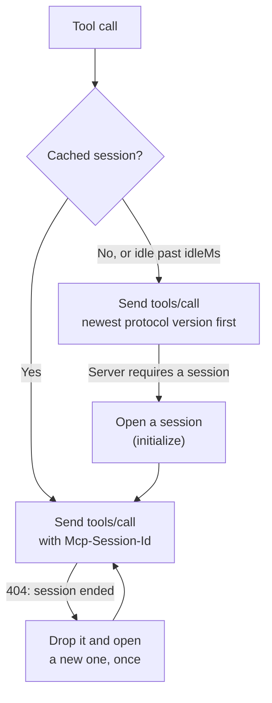

Model Context Protocol (MCP) servers expose tools over JSON-RPC. An `mcp` tool calls one tool on a remote MCP server URL.

Theorem speaks the protocol in the kernel. It negotiates the protocol version, opens a session only when the server requires one, and reopens an expired session, with no connection wrapper or subprocess of your own.

## Registering an MCP Tool

Register MCP tools using `registerTool()` with `type: 'mcp'`:

```ts
import { registerTool } from '@theoremjs/agents';
import { z } from 'zod';

export const webSearchMcpTool = registerTool({
	type: 'mcp',
	name: 'search_maritime_news',
	description: 'Search maritime trade publications and coastal news feeds.',
	category: 'research',
	access: 'read-only',
	paths: ['*'],
	loadTier: 'T0',
	permission: 'auto',

	serverUrl: 'https://mcp.search.example/mcp',
	mcpToolName: 'web_search_news',

	session: {
		idleMs: 120_000, // Reuse a session unused for up to 2 minutes
		max: 5, // Keep at most 5 sessions for this tool
	},

	maxResponseBytes: 2 * 1024 * 1024, // 2 MiB payload cap

	input: z.object({ query: z.string() }),
	output: z.object({
		results: z.array(z.object({ title: z.string(), url: z.string(), snippet: z.string() })),
	}),
});
```

* **`serverUrl`**: The MCP server's Streamable HTTP endpoint.
* **`mcpToolName`**: The name of the tool on the MCP server. The model only sees your tool's `name`, `description`, and `input` schema.
* **`session`**: How long and how many of this tool's server sessions the kernel keeps. Left out, there is no limit.

## Protocol Versions and Sessions

Each call is a JSON-RPC `tools/call` request sent as an HTTP POST. Theorem speaks four protocol versions and tries them newest first, moving to the next when the server refuses one: `2026-07-28`, `2025-11-25`, `2025-06-18`, then `2025-03-26`. If the server refuses them all, the call fails with `mcp_protocol_error`. The `2026-07-28` revision is stateless: each request carries its own protocol version, and no handshake runs.

Some servers refuse a call without an `Mcp-Session-Id`. Only for those does Theorem open a session (`initialize`, then `notifications/initialized`) and keep it in memory on the tool registry. It reads back only the session ID and protocol version; the server's `instructions` are not read. Sessions are never persisted, and losing one costs one reopen.



### Session Behaviour

* **Idle Expiration (`idleMs`)**: A session unused for longer than `idleMs` is not reused; the next call starts again and opens a new session if the server requires one.
* **Session Limit (`max`)**: The kernel keeps each tool's sessions in least-recently-used order. Past `max`, the least recently used session is dropped.
* **Shared Opening**: Parallel calls that need a session for the same server and credential share one `initialize`.
* **Credential Isolation**: The session key is a SHA-256 hash of the server URL and the headers sent to it, the tool's `headers` and its credential included. Each server and credential gets its own session, and the credential itself is never kept.
* **Recovery**: When a server answers `404` to a call that carried a session, Theorem drops that session and opens a new one, once. If the server ends the new session too, the call fails with `mcp_session_expired`.

## Responses & Protection

The kernel accepts the server's response as a JSON body or as a Server-Sent Events (`text/event-stream`) stream.

* **Results**: When the server sends `structuredContent` that fits your `output` schema, that is the output. Otherwise the text content is used, and a `structuredContent` that does not fit raises an `mcp_structured_mismatch` warning. Image and audio content reaches the model as media parts.
* **Payload Capping**: Set `maxResponseBytes` to cap the response body the kernel reads. Left out, there is no limit. A body past it fails the call with `response_too_large`.
* **Authenticated MCP Servers**: Pass an `auth` block (see [Auth & Credentials](/docs/tools/auth)) to attach OAuth tokens or API keys to the session opening and tool calls.
* **Pictures by Address**: Set the `images` hook (and `imageLimits`) to fetch image URLs named in the tool's output and hand them to the model as image parts, as on [HTTP tools](/docs/tools/http).

## Related Guides

* **[Tools & Execution Pipeline](/docs/tools)**: Universal tool attributes, pipeline stages, and dynamic loading.
* **[HTTP Tools](/docs/tools/http)**: Calling standard REST endpoints.
* **[Agent Tools](/docs/tools/agent)**: Delegating tasks to other registered agents.
* **[Auth & Credentials](/docs/tools/auth)**: Authenticating MCP tools with OAuth or bearer tokens.
