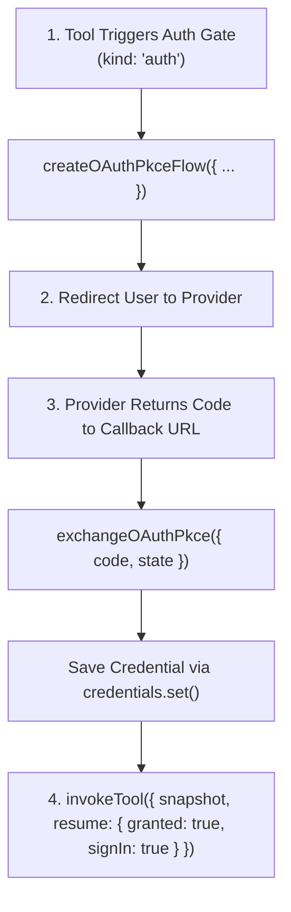

Theorem includes native helpers for OAuth 2.0 with Proof Key for Code Exchange (PKCE, RFC 7636). Host applications can manage user authorizations without third-party OAuth libraries or session database tables.

The OAuth lifecycle operates through three stages: initiating the flow during a turn, exchanging the authorization code on a callback route, and resuming the held tool call.



## What You Need From GitHub

This page signs a person in to GitHub for `list_my_repos`, the tool you add in [Auth & Credentials](/docs/tools/auth). The cookbook does not ship that tool or this flow. These facts about GitHub were checked on 30 October 2026:

* **Sign in against the MCP server.** `https://api.githubcopilot.com/mcp` publishes RFC 9728 metadata that names the issuer `https://github.com/login/oauth`, which advertises S256. Theorem finds the endpoints from that.
* **`api.github.com` publishes no metadata.** Discovery fails there. For a service like this, pass the endpoints in `preResolved`.
* **Register an OAuth App.** It gives you a client id and a client secret. GitHub's web flow requires the secret at the token endpoint. The app's callback URL must be your `redirectUri`.
* **Pass `iss` to the exchange.** GitHub's metadata says it sends `iss`, so a callback without it is refused.

## 1. Initiate PKCE Flow

When a turn halts on an auth gate (`kind: 'auth'`), initiate the authorization request using `createOAuthPkceFlow()`:

```ts
import type { ToolGate } from '@theoremjs/agents';
import { createOAuthPkceFlow } from '@theoremjs/agents/kernel';

// `gate` is the `gate` of the held call's tool event (`phase: 'gate'`).
export async function startSignIn(gate: ToolGate) {
	if (gate.kind !== 'auth') return;
	const flow = await createOAuthPkceFlow({
		resourceServerUrl: 'https://api.githubcopilot.com/mcp',
		clientId: process.env.GITHUB_CLIENT_ID ?? '',
		redirectUri: 'https://app.example/oauth/callback',
		scopes: gate.authChallenge.requiredScopes,
		signingSecret: process.env.OAUTH_STATE_SECRET ?? '',
		sessionBinding: userSessionId,
	});

	// Redirect browser to authorization provider
	redirect(flow.authorizationUrl);
}
```

### Security Parameters

* **`signingSecret`**: A secret key of 32 bytes or more maintained on your server. Theorem encrypts the PKCE code verifier and state parameters into the OAuth `state` string. This allows your callback route to verify and complete the exchange without storing pending flow state in a database.
* **`sessionBinding`**: A unique identifier tied to the user's active browser session. Theorem verifies that the callback originates from the identical session that started the authorization, preventing session-fixation attacks.
* **`resourceServerUrl`**: The https URL of the service, such as an MCP server, and the token's audience (RFC 8707). The token goes only to this origin, at this path or below it. Without RFC 9728 metadata of its own, the URL is treated as its own authorization server.
* **`preResolved`**: Optional. The `issuer`, `authorizationEndpoint` and `tokenEndpoint` to use in place of discovery.

## 2. Exchange Authorization Code

On your callback endpoint, exchange the authorization code for tokens using `exchangeOAuthPkce()` and persist the credential:

```ts
import { exchangeOAuthPkce } from '@theoremjs/agents/kernel';

const { credential } = await exchangeOAuthPkce({
	code: callbackParams.get('code') ?? '',
	state: callbackParams.get('state') ?? '',
	iss: callbackParams.get('iss') ?? undefined,
	redirectUri: 'https://app.example/oauth/callback',
	signingSecret: process.env.OAUTH_STATE_SECRET ?? '',
	sessionBinding: userSessionId,
	clientSecret: process.env.GITHUB_CLIENT_SECRET, // A confidential client's secret; GitHub requires it
});

// Save credential into your application's credential store
await userCredentials.set('github', credential);
```

The code exchange refuses a callback that is not safe:
1. **Session Match**: Refuses a callback whose session binding does not match the one that started the flow.
2. **Redirect Match**: Refuses a `redirectUri` that is not the one that started the flow.
3. **Issuer Verification**: Requires the RFC 9207 `iss` value when the server's metadata advertises it, and refuses one that does not match.
4. **Sealed Token Endpoint**: Sends the code only to the token endpoint sealed in `state`, never to one the caller gives.
5. **Scope Enforcement**: Refuses a token that grants scopes that were not requested. A grant may join its scopes with commas, as GitHub's `repo,gist` does: each part is checked.
6. **No Redirects**: Does not follow a redirect during a token request.

## 3. Resume the Held Tool Call

With the credential persisted in your `ToolCredentialSource`, resume the gated tool call using `invokeTool()`:

```ts frame=statements
const _resumeEvents = invokeTool({
	profile: 'research.scout',
	name: gated.name,
	input: gated.arguments,
	// ...
	resume: {
		granted: true,
		signIn: true,
	},
	credentials: userCredentials,
});
```

* Setting `signIn: true` notifies the model that authentication succeeded before returning the tool result.
* If sign-in was cancelled or declined, pass `granted: false` with `signIn: true` and `cause: 'declined'`.

## Automatic Token Refresh

OAuth access tokens expire. When a tool with an OAuth credential executes, Theorem checks the token's expiration:

* If the access token is within 30 seconds of its expiry and a `refreshToken` is present, Theorem automatically exchanges the refresh token before executing the tool call. A confidential client's secret comes from `credentials.clientSecret`.
* With no `refreshToken`, the tool's `onUnauthenticated` policy applies.
* The kernel saves the newly issued tokens to your `credentials` source via `credentials.set()` before dispatching the request.
* Concurrent calls that find the same expired token share a single refresh request.

## Related Guides

* **[Auth & Credentials](/docs/tools/auth)**: Credential isolation, tool `auth` configuration, and `ToolCredentialSource`.
* **[Tool Permissions & Gates](/docs/tools/gates)**: Gate lifecycle and `invokeTool()` resumption mechanics.
* **[Tools & Execution Pipeline](/docs/tools)**: Registering function, HTTP, and MCP tools.
