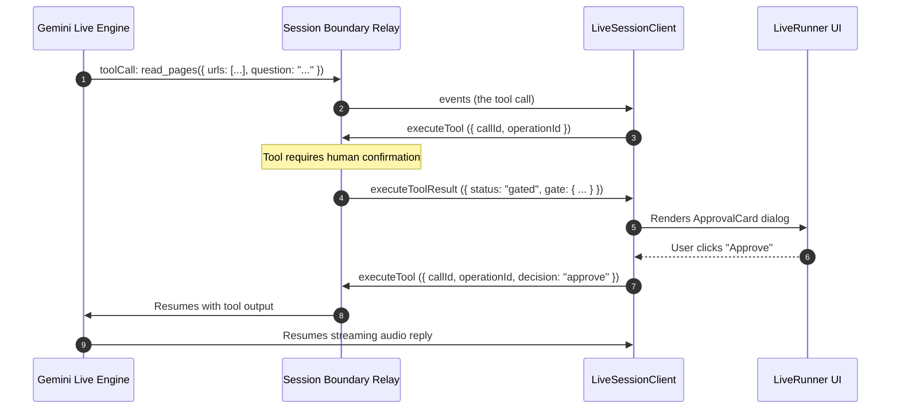

Building responsive, bidirectional voice and video agents in the browser requires low-latency audio capture, streaming playback, barge-in interruption handling, and acoustic echo suppression. Coordinating these media streams on the main JavaScript thread causes UI frame drops, audio stuttering, and dropped network packets.

Theorem implements a dedicated native browser media pipeline in `@theoremjs/web/client` and `@theoremjs/react/live`. Heavy audio processing runs entirely in background `AudioWorklet` threads, while the Web Audio API coordinates low-latency, gapless voice synthesis.

## The Realtime Media Architecture

Duplex streaming connects the browser to an upstream live provider via a WebSocket relay. Rather than requiring WebRTC peer negotiation and ICE/STUN/TURN infrastructure, Theorem streams native PCM audio chunks and JPEG video frames directly over a bidirectional WebSocket (`/api/live/relay`):

```mermaid
flowchart TD
		subgraph Browser["Browser Client (@theoremjs/web/client)"]
				Mic["Microphone Stream"] --> Worklet["AudioWorklet (mic-capture.js)<br/>16kHz PCM Downsampling"]
				Worklet --> QuietGate{"Quiet-Mic Gate<br/>(Speaker Bleed Guard)"}
				QuietGate -->|16kHz PCM Chunks| WSOut["WebSocket Outbound (/api/live/relay)"]
				
				Camera["Camera Video Stream"] --> FrameCap["Frame Capture (Canvas JPEG)"]
				FrameCap -->|client.sendVideo()| WSOut
				
				WSIn["WebSocket Inbound"] --> Decode["24kHz PCM Decoder"]
				Decode --> AudioCtx["Web Audio API (AudioContext)<br/>Gapless Playback Scheduler"]
				AudioCtx --> Speaker["Device Speaker"]
				
				WSIn --> Interruption{"Barge-In Detector"}
				Interruption -->|client.cancelPlayback()| AudioCtx
		end

		subgraph Server["Server Relay (@theoremjs/web/server)"]
				WSOut --> Boundary["Session Boundary<br/>prepareLiveOpen()"]
				Boundary --> Upstream["Gemini Live Gateway<br/>(runSession)"]
				Upstream --> WSIn
		end
```

## 1. Background Audio Ingestion (`AudioWorklet`)

Microphone input is captured at hardware sample rates (typically 44.1kHz or 48kHz) and downsampled off the main thread to 16-bit 16kHz linear PCM, matching upstream provider specifications.

### Automatic Worklet Ingestion

When instantiating `LiveSessionClient`, audio processing is completely automated:

1. `client.connect()` asks for the microphone with `navigator.mediaDevices.getUserMedia`: one channel, with echo cancellation, noise suppression, and gain control. Set `voiceIngress: false` to skip the microphone; the call still receives the model's audio.
2. The client instantiates a browser `AudioContext` and loads the internal `mic-capture.js` worklet module.
3. The worklet converts incoming multi-channel float audio into single-channel 16kHz 16-bit signed integer PCM.
4. Downsampled frames stream over the WebSocket without blocking UI rendering or main-thread React updates.

The metering callback `onVolumeLevel(level, isUser)` reports a level in the range $[0, 1]$: the microphone's when `isUser` is true, the model's playback when it is false. It can drive waveform bars such as `InkWaveform`.

## 2. Gapless 24kHz Playback Scheduling

Upstream providers return streaming model audio in variable-length 24kHz PCM chunks. Naively playing each chunk with `HTMLAudioElement.play()` results in audible clicks and gaps between network packets.

`LiveSessionClient` manages a buffer queue on the Web Audio API clock:

```text
// Schedule incoming PCM chunks along the Web Audio clock
let nextPlayTime = audioContext.currentTime;

function enqueueAudioChunk(pcmData: Float32Array, sampleRate = 24000) {
	const buffer = audioContext.createBuffer(1, pcmData.length, sampleRate);
	buffer.copyToChannel(pcmData, 0);

	const sourceNode = audioContext.createBufferSource();
	sourceNode.buffer = buffer;
	sourceNode.connect(audioContext.destination);

	// Guarantee gapless continuity: schedule immediately after prior chunk
	const startTime = Math.max(audioContext.currentTime, nextPlayTime);
	sourceNode.start(startTime);
	nextPlayTime = startTime + buffer.duration;
}
```

By queuing chunks relative to `audioContext.currentTime`, audio playback remains perfectly smooth even when network packets arrive in jittered batches.

## 3. Barge-In Interruption & Acoustic Gating

Conversational realism requires that a user can interrupt the model mid-sentence. However, device speakers often bleed audio back into the microphone, which naive detection engines mistake for user speech, causing the agent to interrupt itself.

Theorem employs a two-tier acoustic defense:

### Instant Buffer Flushing (Barge-In)
When the server emits an interruption signal or the user speaks over the agent, `LiveSessionClient.cancelPlayback()` immediately stops and disconnects all scheduled `AudioBufferSourceNode` instances, resetting `nextPlayTime` to `audioContext.currentTime`. The model ceases speaking with zero perceptual latency.

### The Quiet-Mic Echo Gate
While model audio is actively playing through the speaker, Theorem's client-side microphone gate drops quiet frames below an RMS of 0.05:
1. Low-amplitude acoustic bleed from the speakers (alongside keyboard clicks and ambient room noise) sits below 0.05 RMS and is dropped locally before transmission.
2. High-amplitude intentional user speech immediately crosses 0.05 RMS, streaming to the relay and triggering server-side interruption.

## 4. Video & Multimodal Camera Streaming

Realtime sessions ingest live video frames from device cameras over the same WebSocket connection.

### Headless Video Dispatch

Custom applications can capture frames from any HTML5 video stream and transmit them using `client.sendVideo(data, mimeType)`. `mimeType` defaults to `'image/jpeg'`. A frame sent while the socket is not open is dropped.

The client runs the tools the model calls on the relay. [Headless Client Management](#headless-client-management) adds the page's tools and an answer to a gate:

```ts frame=statements
import { LiveSessionClient } from '@theoremjs/web/client';

const client = new LiveSessionClient({ profile: 'research.scout.live' });
await client.connect();

const canvas = document.createElement('canvas');
// ...
const base64Jpeg = canvas.toDataURL('image/jpeg', 0.62).split(',')[1];
if (base64Jpeg) client.sendVideo(base64Jpeg);
```

### Declarative React Video

For high-level applications, `LiveRunner` from `@theoremjs/react/live` automates camera acquisition, device toggling (`facingMode: 'user' | 'environment'`), canvas downsampling (640x480 at 400ms intervals), and video preview rendering:

```tsx
import { LiveRunner } from '@theoremjs/react/live';

<LiveRunner
	iface={iface}
	connection={() => ({ profile: 'research.scout.live' })}
/>
```

## 5. Live Tool Execution & Mid-Call Gates

Models can execute tools during an active voice stream without closing the WebSocket connection:



Every tool of `research.scout.live` runs without asking, so this diagram needs `permission: 'always_confirm'` added to `read_pages`. If a tool requires user approval, the call does not drop. The audio connection remains open in a listening state while the UI renders a modal approval card. Once approved, the tool result is returned over the WebSocket, and the agent continues speaking naturally.

## Headless Client Management

Instantiate and manage realtime sessions using `LiveSessionClient`. With no `relayUrl`, it connects to `/api/live/relay` on the page's own host, with the profile in the query:

```ts frame=statements
import { LiveSessionClient, type LiveSessionStatus } from '@theoremjs/web/client';

const client = new LiveSessionClient({
	profile: 'research.scout.live',
	onStatusChange: (status: LiveSessionStatus) => {
		console.log('Call status:', status); // 'disconnected' | 'connecting' | 'reconnecting' | 'ready' | 'listening' | 'speaking' | 'working' | 'error'
	},
	onTranscript: (text: string, isUser: boolean, meta?: { interim?: boolean }) => {
		// ...
	},
	onVolumeLevel: (level: number, isUser: boolean) => {
		// ...
	},
	// A tool the profile declares with answeredBy: 'page'
	pageTools: {
		check_device: () => ({
			output: {
				webgpu: 'gpu' in navigator,
				// ...
			},
		}),
	},
	// Ask the person, then send their answer to the gate
	onGate: async ({ toolName }) =>
		window.confirm(`Run ${toolName}?`) ? { decision: 'approve' } : { decision: 'deny' },
	onError: (error: Error) => {
		// ...
	},
});

await client.connect();

// Mute/unmute microphone; returns true when muted
client.toggleMute();

// Send text utterance mid-call
client.sendText('Look for datasets that test long context memory.');

// Clean disconnect
client.disconnect();
```

The client runs each call the model makes on the relay, one at a time, and answers every step itself:

- **A page tool**: The relay sends the call to the page. The client answers with the `pageTools` function of that name. A tool with no function, or a function that throws, is answered with no answer, and the console says once that the tool has no function. The turn does not wait for it.
- **A gate**: The client asks `onGate`. A sign-in gate's approval carries the key the person typed as `secret`. `continueGatedToolInvocation` turns the person's answer into the reply. Without `onGate`, every gate is refused.

The session answers the model however the call ends. Calls run in order, so a page function that never returns holds every call after it.

If a network interruption drops the WebSocket, `LiveSessionClient` automatically attempts reconnection with exponential backoff (`[500, 1000, 2000, 4000, 8000]` ms) and resumes the session state using the provider's active continuation checkpoint.

## Related Guides

* **[Live Profiles](/docs/profiles/live)**: Declaring duplex audio, voice parameters, and context compression on the profile.
* **[Headless Web & Transport](/docs/web)**: Web-standard server route dispatchers and conversation stores.
* **[Headless React Hooks](/docs/web/react-hooks)**: Consuming chat, decision, and embedding transports in React.
* **[Astryx UI Components](/docs/web/astryx)**: Pre-assembled `<LiveRunner />` console with visual waveforms and captions.
